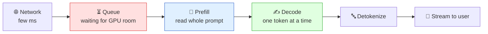
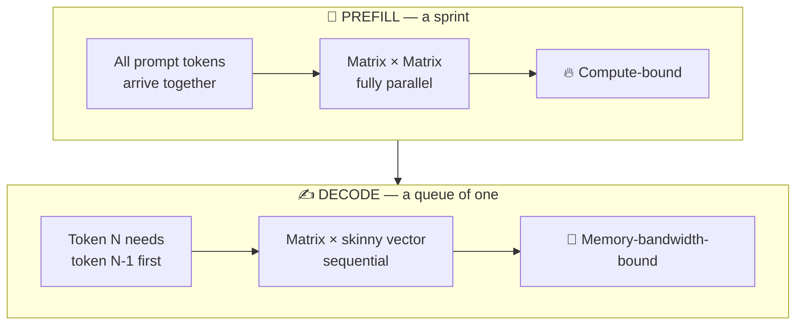
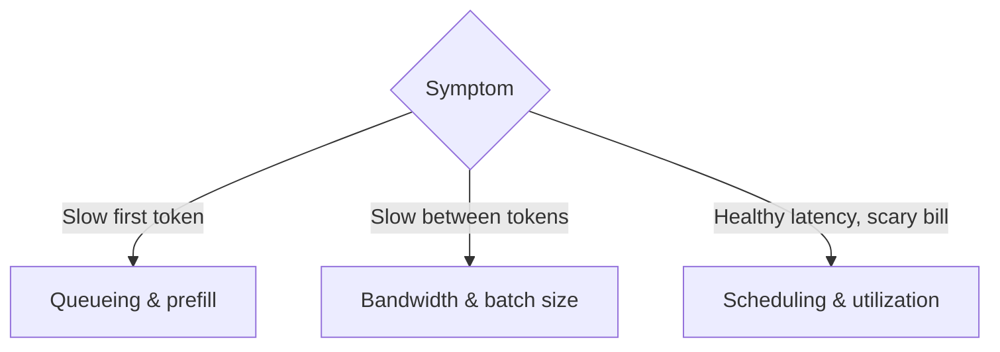

# 🚕 Chapter 0 — Orientation & the Request Map

*Episodes 00 – 01*

## Training vs inference

| | 🚗 Training | 🚕 Inference |
| --- | --- | --- |
| Analogy | Buying the car | The taxi meter |
| Bill | One big bill, then done | Keeps running as long as the product is live |
| Who pays | Model builder | **You**, once you run open weights yourself |

Open-weight models changed who owns the meter. Once you self-host, you control **latency, availability and cost**, and the work of optimizing them is now yours.

---

## 🗺️ The six stages of one request

::: danger ⏳ The hidden stage: the queue
Nothing is computed while a request waits in the queue. **Benchmarks don't queue**, but your user's clock started when they hit enter.
:::

---

## 📖 Prefill vs ✍️ Decode — two different programs

There are only **two reasons** anything is slow:

1. **Waiting on arithmetic** → *compute-bound* (prefill usually lives here)
2. **Waiting on memory** → *memory-bandwidth-bound* (decode lives here almost permanently: it drags the **whole model** across the bus for every token and uses it once)

---

## 📏 The four numbers to live with

| Metric | Meaning | What it really is |
| --- | --- | --- |
| **TTFT** — time to first token | Enter → first word on screen | Queue + Prefill |
| **ITL** — inter-token latency | Gap between words | A *distribution*. Stalls show up in the tail |
| **Throughput** | Requests finished per second | Capacity & cost modelling |
| **Goodput** ⭐ | Requests finished **within SLO** | What actually helped someone |

> A response that arrives after the user closed the tab still counts toward throughput. It doesn't count toward goodput.

---

## 🧭 The symptom → cause tree

### 🚫 Out of scope for this course
Training, fine-tuning, retrieval quality, prompt design, agent logic. **This course starts once the model exists and a request has arrived.**

::: tip ✅ Homework
Open your production dashboard. Can you see all four numbers? Most teams find they only have throughput.
:::
