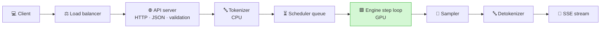
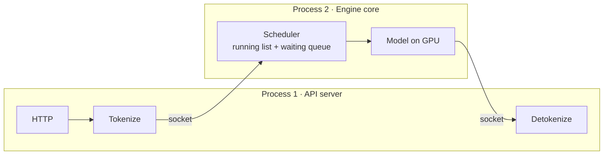
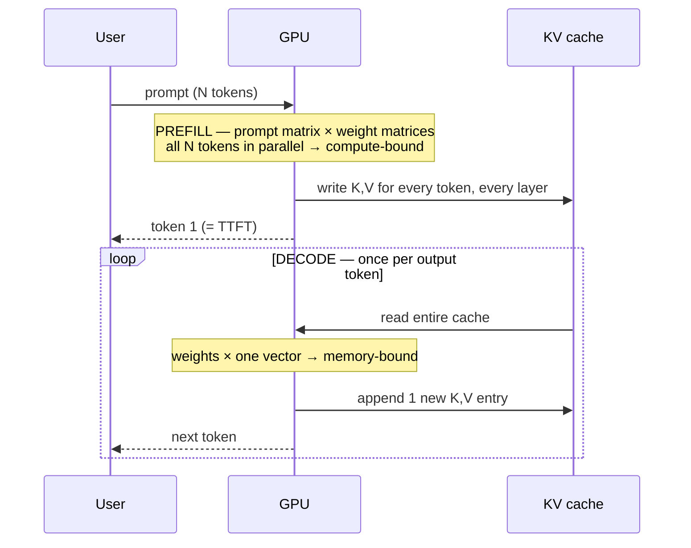
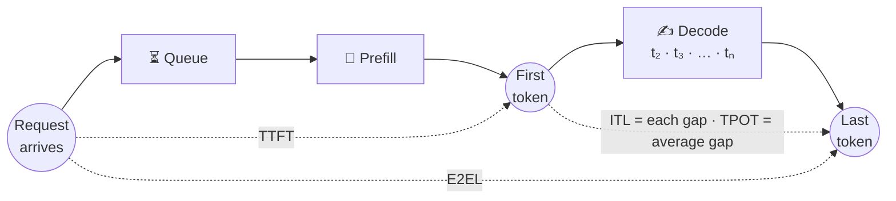
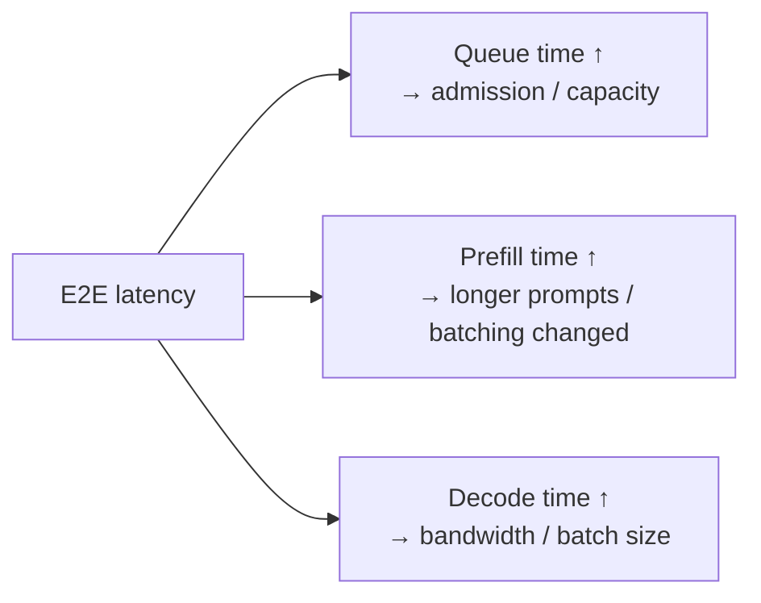
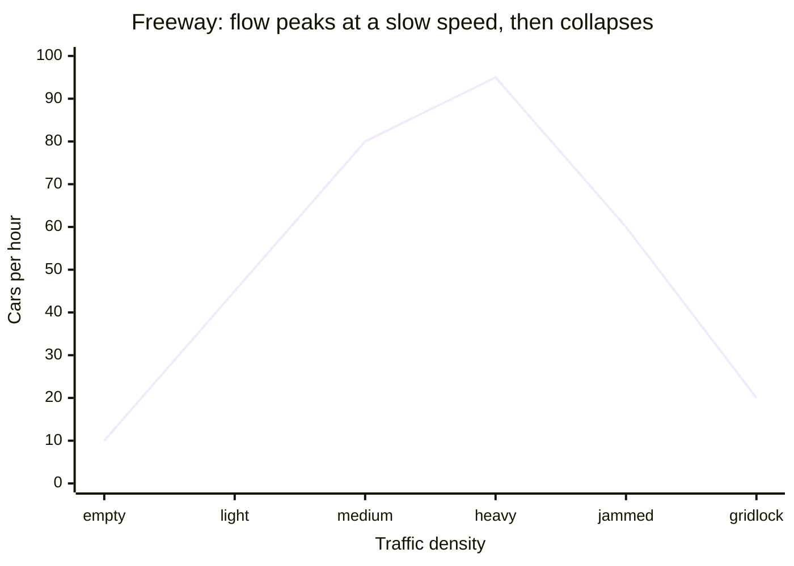
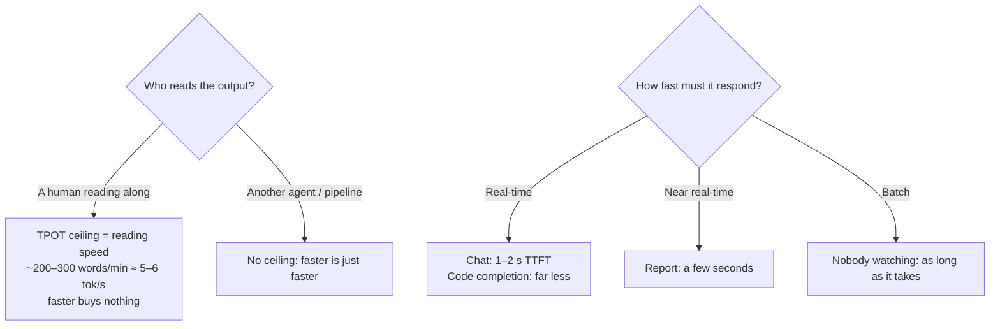
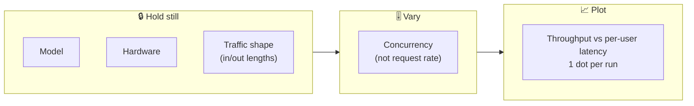

# 🛣️ Chapter 1 — Request Lifecycle, Metrics & Benchmarking

*Episodes 02 – 07*

## 1. From HTTP to token: the 8 hops

**Only one of the 8 hops is the GPU.** "The model is slow" usually means all 8 hops added together and blamed on one of them.

### vLLM V1: keeping housekeeping off the critical path

- vLLM (Jan 2025) split the engine into **two OS processes** so Python work no longer blocks the GPU.
- The scheduler keeps two lists: **running** and **waiting**. The gap between them is your **queue time**.
- A scheduling decision is just a dict: `{request_id: num_tokens}`. In the scheduler there is no separate "prefill phase" or "decode phase" any more.
- TensorRT-LLM + Triton and SGLang use the **same six jobs**. They only draw the process boundaries in different places.

### 🕵️ Five hidden time sinks (none show up in a model benchmark)

| # | Sink | Why it hurts |
| --- | --- | --- |
| 1 | Tokenization | CPU, often single-threaded; long prompts cost real ms |
| 2 | Detokenization | Tiny per token, repeated thousands of times |
| 3 | HTTP / streaming | Per-chunk overhead; flushing every token on mobile |
| 4 | Python GC | Random pauses, invisible in model metrics |
| 5 | The GIL | Python threads take turns instead of running in parallel |

::: tip 🛠️ Monday action: instrument the hops
Timestamp **arrival → tokenized → left queue → first token → done**. Without these five numbers, every latency discussion is opinion.
:::

---

## 2. Prefill vs decode: the asymmetry

- **KV cache**: prefill fills it once, decode reuses it. Without it, every step would recompute the whole conversation.
- **The van analogy 🚐**: each decode step drives to the warehouse (HBM), loads *all* the weights, delivers **one parcel**, and drives back. At batch 1, a step costs about the same whether it makes 1 token or 100.
- **Batching = filling the van.** One weight read, many requests' tokens. That's the whole mechanism.

::: warning ⚠️ Don't optimize attention first
"Attention is quadratic" makes it *feel* like the bottleneck. At the sequence lengths most production traffic uses, the **linear layers dominate**. Attention only overtakes at very long prompts. Measure first.
:::

📄 *Papers: SARATHI (prefill/decode asymmetry, chunked prefill), Pope et al. "Efficiently Scaling Transformer Inference".*

---

## 3. Latency metrics, and why averages lie

| Metric | Definition | Type |
| --- | --- | --- |
| **TTFT** | Arrival → first token (queue + prefill) | single wait |
| **ITL** | Gap between consecutive tokens | **distribution** (measured hundreds of times) |
| **TPOT** 🫖 ("tea pot") | Generation time ÷ tokens produced | **average** per request |
| **E2EL** | Arrival → last token | one total |

::: danger 🫖 TPOT is an average, so it hides stalls
**Etalon paper** (vLLM, Yi-34B, 2× H100, arXiv summarization at ~1.5 req/s, a quiet afternoon):
- 60% of requests waited **> 25 s** in the queue
- The median request produced 228 tokens
- 25 s ÷ 228 tokens ≈ **110 ms "per token"**, so a 25-second freeze shows up on the dashboard as about 100 ms
:::

**Rules:**
- Plot **TPOT next to p99 ITL**. Never read one without the other.
- If every alert threshold is set on an average, **you have no alert on stalls**.
- vLLM's metrics page puts ITL and TPOT on one histogram. Check what your tool actually computes.
- Vendor TTFT numbers come from **idle servers** (queue = 0). Treat them as a **floor**.
- With chunked prefill (on by default), ITL on a busy server tells you what the **scheduler** did, not pure decode.

### 🧩 Decompose E2E latency into three

---

## 4. Throughput vs goodput 🛣️

**Three different "throughputs"**, explained with a freeway:

| Throughput | Freeway analogy | Who feels it |
| --- | --- | --- |
| Total output tokens/s | All cars passing a point, all lanes | Vendor slides (biggest number) |
| Requests/s | Whole trips completed | Capacity planning |
| Tokens/s **per user** | How fast *your* car is moving | **The user** ✅ |

> A throughput number with no latency next to it is **a traffic jam somebody's proud of**.

- **Goodput** = only the requests under your SLO. In vLLM's benchmark you pass a TTFT threshold and a TPOT threshold.
- Sarathi-Serve finding: systems hit **peak throughput after they've already broken the latency target**.

### 🎯 Setting an SLO when nobody gave you one

📌 **MLPerf reference** (Llama 2 70B, interactive): **TTFT 450 ms**, **TPOT 40 ms**, both measured at **p99**. That's the p99 *of an average*, so keep a p99 ITL panel next to it.

**Little's law**: requests in system = arrival rate × time per request. Useful for **fleet sizing**, not for making inference faster.

---

## 5. The latency–throughput curve: pick your operating point

**Hold 3 things still, vary 1, plot 1:**

vLLM ships a **sweep**: one request at a time first, then all at once, then fills in the middle. Switch it to vary **concurrency**; vLLM's docs say that's more reliable than varying rate.

### Reading a real chart (InferenceX v2, 8K in / 1K out; read off a chart, so approximate)

| System | tok/s **per GPU** | tok/s **per user** | Best for |
| --- | --- | --- | --- |
| GB200 | ~500 | ~130 | 💬 Chat (user feels speed) |
| GB300 | ~600 (+20%) | ~116 (−10%) | 🌙 Overnight batch (cost) |

> **"Which is faster?" depends on where you sit on the curve.** Same company and same model can need opposite hardware.

### 🎯 How to pick the point
1. Draw your **TTFT SLO** line and your **TPOT SLO** line across the curve.
2. Take the **highest throughput where both still hold** (TTFT usually breaks first as queues form).
3. Headroom math: hardware does 90–130 tok/s/user. MLPerf asks for 25 tok/s. Humans read about 5–6 tok/s. So with **human readers**, move left on the curve and spend that headroom on more users. With **agent consumers**, stay on the interactive end.

---

## 6. 🩺 Clinic: how to benchmark without fooling yourself

| ❓ Symptom | 🔍 Cause | 🛠️ Fix |
| --- | --- | --- |
| Great on summarization, bad on reasoning | **Traffic shape changed** (long-in/short-out vs short-in/long-out). Default bench ≈ 1000 in / 128 out | Benchmark *your* shape |
| Per-token timing is noisy | Early EOS → fewer tokens than requested | `--ignore-eos` |
| First numbers terrible | No warm-up (model load, compilation) | Separate warm-up run |
| Second run suspiciously fast | **Prefix cache** remembers your prompts | New seed per run; know if cache is cold or warm |
| Latency climbs the longer you run | Fixed **rate** + server can't keep up → unbounded queue. Default rate = ∞ (stress test) | Fix **concurrency** instead |
| Burstiness setting does nothing | Only applies once a rate is set | — |
| Two tools give different ITL | One excludes the first token, one averages it in; one drains batches (concurrency drops to 0) | Know your tool |
| New chip "3× faster" isn't | Each vendor row uses its own tuned software stack | Ask: *what else differs?* Check the date |

::: tip 📋 Benchmark checklist (screenshot this)
**Hold still:** model · hardware · server software **+ version + launch flags** (most often forgotten) · traffic shape & its variance · cache fresh/warm
**Choose & record:** fixed rate *or* fixed concurrency
**Label every number:** when published · when retrieved · which version produced it
:::
