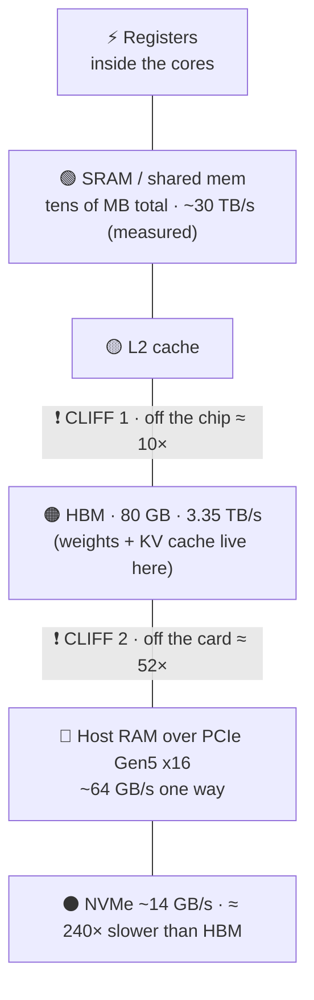
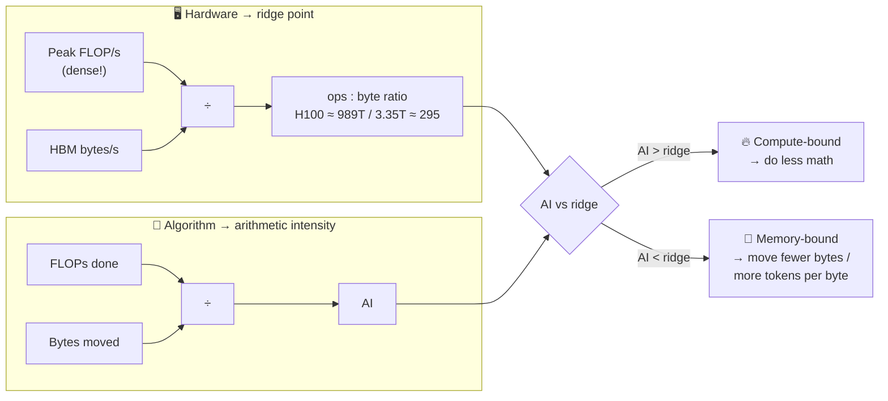
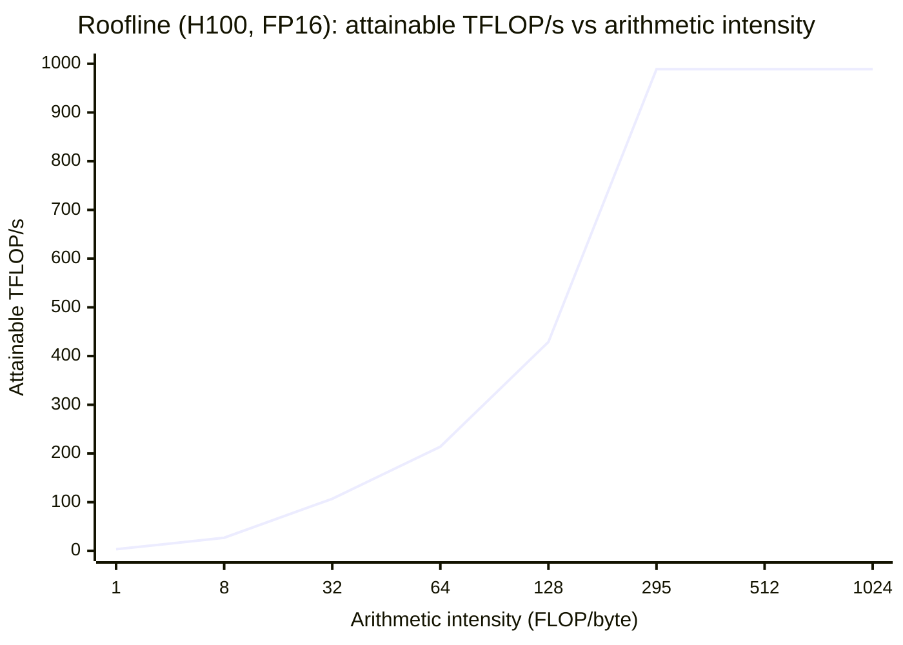
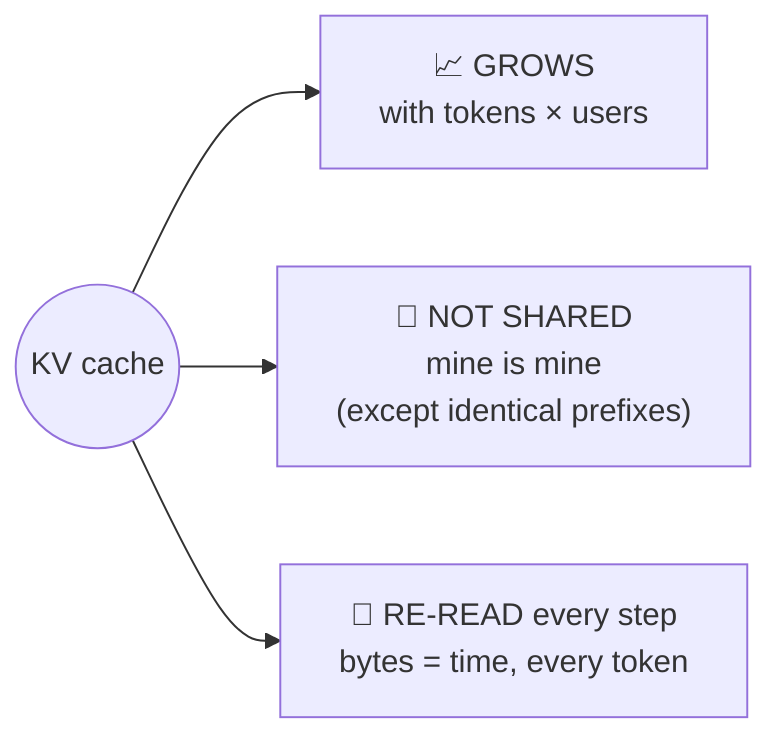
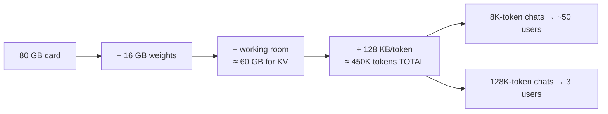
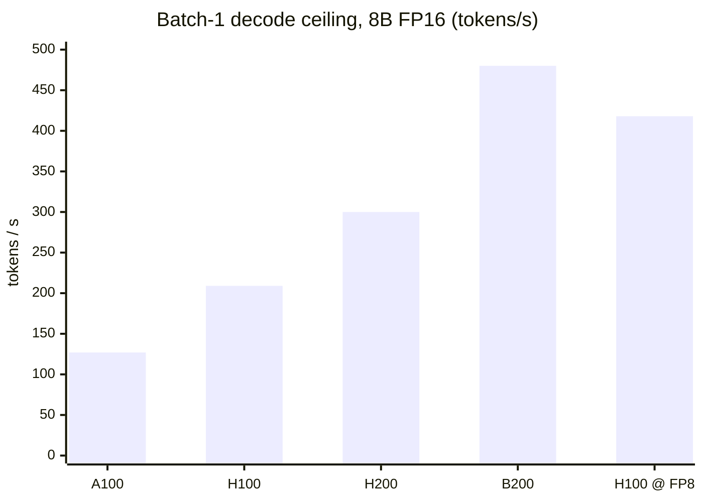
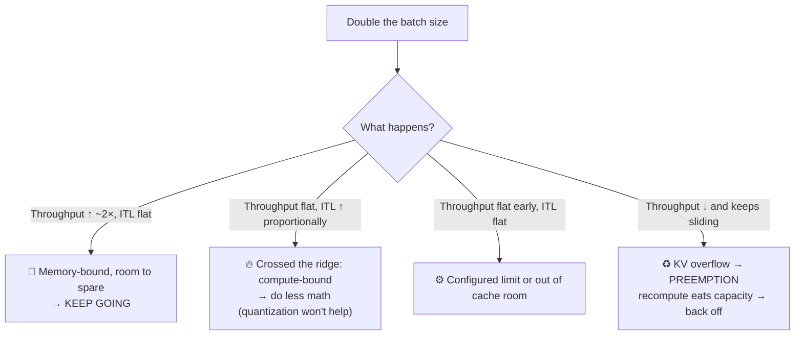
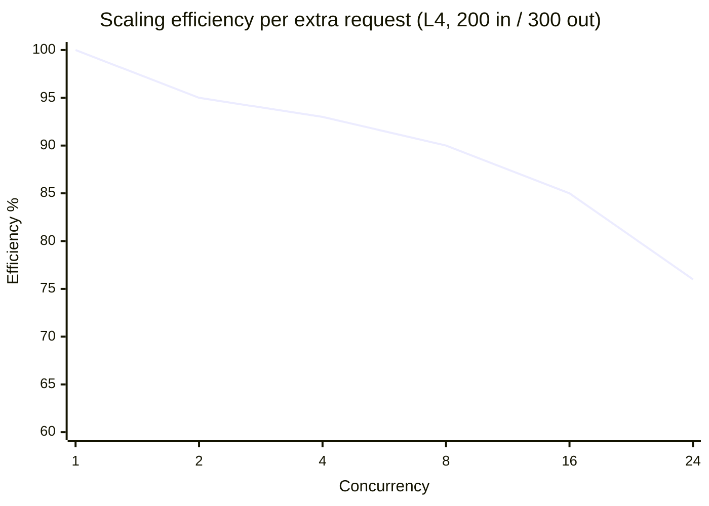

# 🧱 Chapter 2 — The Two Walls: Compute vs Memory

*Episodes 08, 10 – 13, 17 · ⭐ "Don't skip episode 8"*

A GPU can only run out of **two things**: 🧮 **compute** or 📦 **memory bandwidth**. Everything else in the course is about walking up to one of these two walls.

---

## 1. The memory hierarchy (H100)



> **Rule:** the closer to compute, the faster, and the **less of it** you get.

| Cliff | Size | What it causes |
| --- | --- | --- |
| **Off the chip** (SRAM → HBM) | ~10× | Attention's big N×N grid spills to HBM → motivates **FlashAttention** |
| **Off the card** (HBM → host) | ~52× | Offloading the KV cache to host RAM only pays when the alternative is *recomputing the prompt* |

🔌 **NVLink-C2C** (Grace-Hopper style): 900 GB/s bidirectional vs PCIe's 128 GB/s bidirectional, about **7×**. On those machines cliff 2 is just a step.

---

## 2. Arithmetic intensity vs the ridge point ⭐



### The roofline picture



### Why decode ≈ 1 FLOP/byte (on *any* model)

For an **8B model in FP16**: weights = 16 GB.
- Work: ~**2 FLOPs per weight** (multiply + add)
- Bytes: **2 bytes per weight**
- → **AI ≈ 1**, against the H100's 295, so **~300× short**

Weights and work both scale with parameter count, so **70B and 405B also give ≈ 1**. This comes from generating one token at a time, not from model size.

| Stage | Weights loaded once, used by… | AI | Wall |
| --- | --- | --- | --- |
| Prefill | thousands of prompt tokens | high | 🔥 compute |
| Decode (batch 1) | 1 token | ≈ 1 | 🧊 memory |
| Decode (batch 8) | 8 tokens | ≈ 8 | 🧊 still memory |

**Two escape routes from the memory wall:**
1. **Move fewer bytes** → quantization
2. **More tokens per byte** → batching (it takes far more batching than people expect to reach 295)

---

## 3. Reading spec sheets without getting fooled 📄

::: warning 🔍 Three traps
1. **Mixed-chip comparisons**: "19 TB/s SRAM vs 3.35 TB/s HBM" puts an **A100** figure next to an **H100** figure. Done on one chip, it's still about 10:1.
2. **Sparsity asterisk**: B200 "2.25 / 4.5 PFLOPS" means without / with **2:4 structured sparsity** (2 of every 4 neighboring weights must be exactly zero, which needs pruning + retraining). Your checkpoint uses the **smaller (dense)** number. Measured sparse speedup on Hopper averaged **1.42×, not 2×**.
3. **Comparison tables** mix dense and sparse rows → up to **2× wrong**. If a table doesn't say *dense*, treat the number as unusable.
:::

### H100 vs H200: same compute, different memory

| | H100 | H200 |
| --- | --- | --- |
| Die | GH100 | GH100 (same) |
| FP16 dense | 989 TFLOPS | 989 TFLOPS (same) |
| HBM | 80 GB @ 3.35 TB/s | **141 GB @ 4.8 TB/s** |
| Ridge point | 295 | **206** |

So when someone says the H200 is faster, they mean **bandwidth**. That's exactly what decode needs.

### 📊 Ridge-point cheat sheet (dense FP16 / BF16)

| GPU | Ridge (FLOP/byte) |
| --- | --- |
| A100 | 153 |
| H200 | 206 |
| B200 | ~292 (7.7 TB/s sheet; 281 with 8 TB/s) |
| H100 | 295 |
| MI355X | ~315 |
| L4 | 403 |

> A ridge point belongs to a **precision**, not a chip. At FP8 the H100's becomes about **590**.

---

## 4. KV cache: the bytes that eat your GPU 🍽️

### The formula

```
KV bytes per token = 2 (K and V) × layers × kv_heads × head_dim × bytes_per_value
```

Read `num_hidden_layers`, `num_key_value_heads` and `head_dim` (or `hidden_size / num_attention_heads`) from **`config.json`**.

::: danger ⚠️ Use the KV head count, not the attention head count
Llama-3-8B has **32 attention heads** but only **8 KV heads**. Using 32 makes your estimate 4× too big.
:::

| Model | Layers | KV heads | Per token (FP16) | 128K-token convo |
| --- | --- | --- | --- | --- |
| Llama 3 8B | 32 | 8 | **128 KB** | ~17 GB (> the 16 GB of weights!) |
| Llama 3 70B | 80 | 8 | 320 KB | ~42 GB |
| Llama 3 405B | 126 | 8 | 504 KB | ~66 GB |
| 70B with MHA (64 KV heads) | 80 | 64 | **2.5 MB** | ~340 GB 😱 |
| DeepSeek V3 (MLA) | — | — | **~70 KB** | ~9 GB |

> Model is 50× bigger, but cost per token is only ~4× bigger. **The KV cache follows the model's shape (layers × KV heads), not its parameter count.**

### Three properties of the KV cache



### 🧮 Capacity worksheet: H100 + Llama 3 8B



> Raising the supported context length isn't a config change. It's a **memory purchase**. Price it before you say yes.

---

## 5. MFU vs MBU: "busy" isn't "used"

| | **MFU**: Model FLOPs Utilization | **MBU**: Model Bandwidth Utilization |
| --- | --- | --- |
| Use for | 📖 **Prefill** (compute-bound) | ✍️ **Decode** (memory-bound) |
| Formula | `2 × params × tokens/s ÷ peak dense FLOP/s` | `(weights + KV bytes) ÷ TPOT ÷ peak bandwidth` |
| Example | 8B, 30K tok/s in → 480 TFLOP/s ÷ 989 = **~49%** | 7B FP16 (14 GB) / 14 ms = 1 TB/s ÷ 2 TB/s = **50%** (Databricks) |
| Trap ⚠️ | Using the **sparse** peak halves your MFU (49% → 24%) | Blending MFU+MBU into one number means nothing |
| Trap ⚠️ | Counting **padding tokens** inflates MFU | — |

- *Model* FLOPs = math the model owes for delivered tokens. Hardware FLOPs also count recomputation, which flatters you.
- There's no published "healthy" value. **Baseline yours and alert on drops.**

### 🚀 The decode speed ceiling (batch 1, 100% MBU)

`max tok/s = bandwidth ÷ weight bytes`. For an 8B model in FP16 (16 GB):



Realistic MBU is 60–80%, so an H100 gives about 125–170 tok/s. **FP8 = exactly 2×**: half the bytes, twice the tokens.

---

## 6. 🩺 Clinic: "100% GPU but still slow"

::: danger 🔦 nvidia-smi "GPU-Util" is a light switch with a stopwatch
NVIDIA's definition: *percent of time during which **one or more kernels** was executing.* One kernel on 1 of 132 SMs reads **100%**. Use it for "is anything running", memory used and temperature. **Never** use it for capacity.
:::

### The batch-size sweep (hold prompt/output fixed, walk batch up)

Pick your window first: upper bound = **min(ridge point, KV-cache capacity)**. Test 4–5 points inside it.



**Single-request MBU test:**
- MBU **> ~60%** and throughput won't rise → truly bandwidth-saturated, so **move fewer bytes**
- MBU **low** with GPU going idle between kernels → **software-bound**. Quantizing won't help.

---

## 7. 🧪 Lab: vLLM on one L4 (Qwen3-8B, FP16, ridge 403)

| Measurement | Result |
| --- | --- |
| Pure decode, batch 1 | **MFU 0.22%**, **MBU 84%**, AI ≈ 1 (385× below ridge) |
| Concurrency 1 → 32 | **16 → 382 tok/s (23×)** |
| ITL 1 → 32 | 60 ms → 79 ms (only ~⅓ worse) |
| TTFT 1 → 32 | 0.1 s → 1.3 s (**13× worse**, queueing behind a full batch) |
| Bytes per output token | **15.3 GB → ~0.55 GB (28× fewer)** |
| nvidia-smi across all 9 runs | **100%, spread = 0** (while output varied 36×) |



🎯 **Two reference points**: **16** (latency-constrained: 225 tok/s, TTFT ~0.75 s) and **32** (throughput: 382 tok/s, TTFT ~1.3 s). Judge every later optimization against both.

::: warning 🪤 Three traps that gave plausible but wrong numbers
1. **MBU = 122%**: built-in warm-up traffic was counted in the counters but not in the duration → run warm-up as a **separate command**.
2. **Reused seed** → 94% prefix-cache hit → fake-fast prefill → **new seed per run**.
3. **FLOP counters read exactly 0**: a server flag was needed for them to exist. Zero looks like an idle GPU.
:::

Caveats: vLLM's MFU is estimated from tensor shapes. MBU is a **floor** (it excludes KV traffic). The preemption "knee" was never reached (preemptions = 0 at batch 32).
