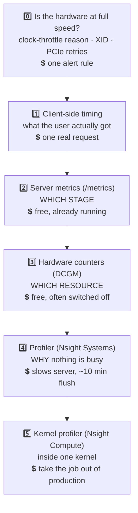
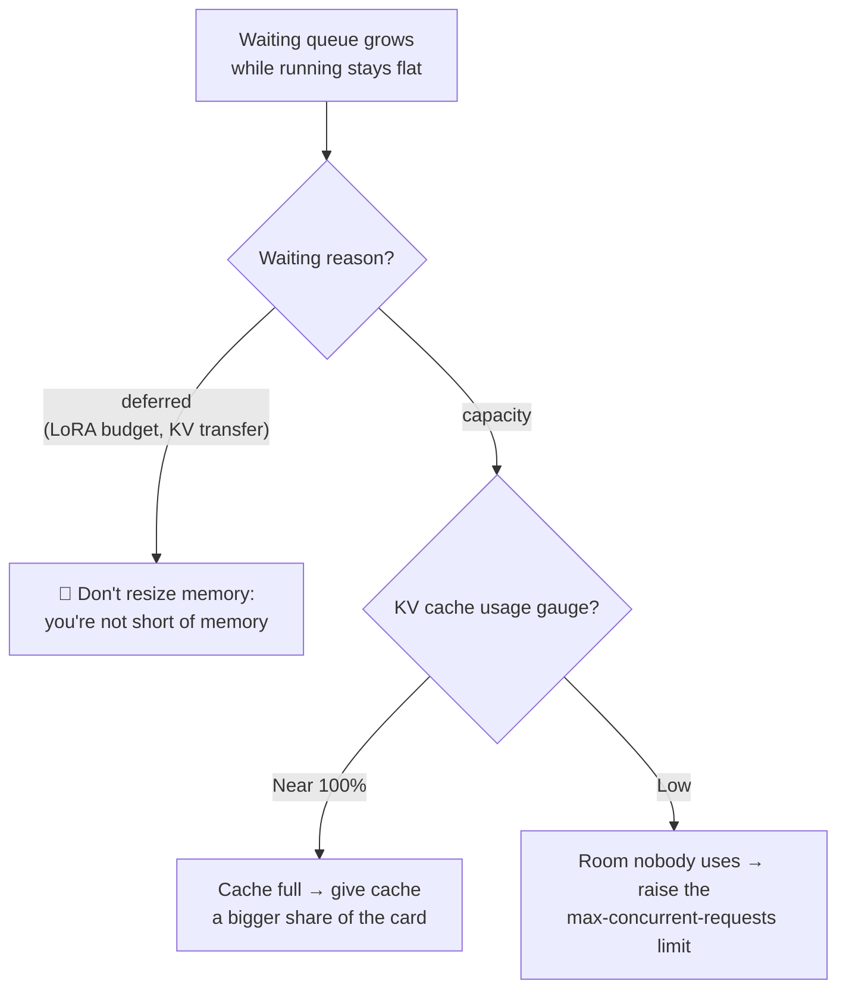
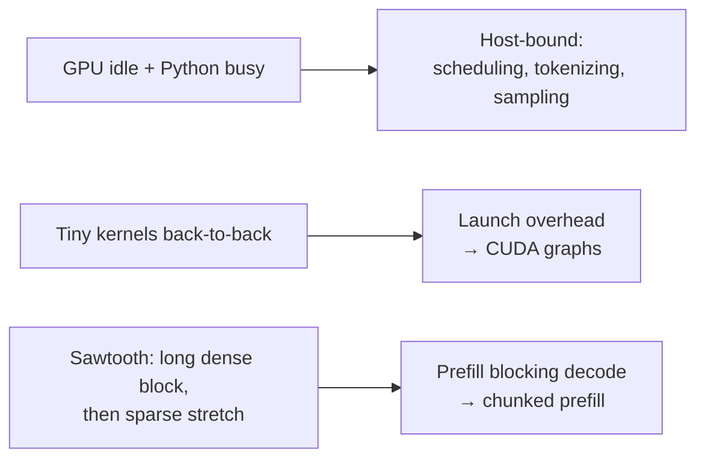

# 🔭 Chapter 3 — Observability: What to Measure

*Episodes 14 – 16*

## 🪜 The instrument ladder (cheapest first)

> Each instrument sees out to a certain distance and then stops, **and it won't tell you it stopped**. It just answers.

---

## 1. 📊 A dashboard built on four questions

Each panel should answer **one question** you'd ask at 2 a.m. Build panels around the questions, not around metric names, because names change between vLLM, SGLang and TRT-LLM versions.

### Q1. Is anything waiting, and why?

### Q2. Where did the time go?
**E2E = queue + prefill + decode.** (TTFT includes the queue.)
- Queue ↑ → capacity (back to Q1)
- Prefill ↑ → longer prompts or batching changed
- Decode ↑ (others flat) → memory bandwidth

::: warning 📉 Histogram percentiles are estimates
The buckets are coarse and fixed, so a percentile is **interpolated inside a wide bucket**. Fine for trends, **not** for customer SLAs. Measure SLAs at the client.
:::

### Q3. Is the server redoing work?
- **Preemption counter** rising under steady traffic → admitting more than it can hold, so prompts get paid for twice.
- **Prefix cache hit rate**: vLLM gives raw token counters (hits ÷ queries over any window). SGLang gives a **lifetime** rate, which barely moves when efficiency drops today. Window it yourself.
- **Eviction age vs reuse gap**: if blocks are evicted faster than the typical reuse gap, the reuse is real and **the cache is too small**. Take that number to whoever owns the budget.

### Q4. Am I filling the batch?
- vLLM: **tokens per engine step** histogram. Read the distribution, not the mean.
- Triton: `inference_count ÷ execution_count` = average batch size.

::: danger 🫥 A blank panel looks the same as a healthy one
vLLM renamed the KV-usage gauge and the prefix-cache counters between major versions and removed some outright. **No error, the panel just draws nothing.** Put metric names in **dashboard variables** so a rename is a one-place fix.
:::

---

## 2. 🔬 Hardware counters (DCGM)

| Counter | Question it answers |
| --- | --- |
| **SM active** | Was the *whole card* busy? (a job using ⅕ of the SMs reads 20%, where nvidia-smi would show 100%) |
| **Tensor pipe active** | Are you using the tensor cores you paid for? |
| **DRAM / memory interface active** | How close are you to the bandwidth limit? |
| **NVLink bytes** | Are GPUs talking instead of computing? |

### The verdict card (cross the counters)

| SM | Tensor | Memory | NVLink | Verdict |
| --- | --- | --- | --- | --- |
| busy | quiet | **busy** | — | 🧊 Bandwidth-bound (normal for decode) |
| busy | **busy** | — | — | 🔥 Compute-bound (normal for long prefill) |
| low | low | low | **high** | 📡 Communication-bound → check parallelism / link |
| low | low | low | low | ❓ Nothing saturated → **go to the profiler** |

::: warning 🪑 Occupancy ≠ good usage
Occupancy counts **resident warps** (how full the seats are), not useful work. DCGM: *higher occupancy does not necessarily indicate better GPU usage.* It helps when you're memory-bound (it hides latency) but not when you're compute-bound. Read **tensor-pipe + memory-interface** instead.
:::

### 🔥 The cheapest alert you don't have: clock throttle reasons
Field values: SW power cap · SW thermal slowdown · **HW slowdown** (cuts clocks **≥ 2×**; caused by heat, PSU brake, or fast power cut).

> Everything slows down **in proportion**. Batches still form, cache still fills, every ratio looks normal, so there's no software symptom to find. **Alert on throttle reason ≠ 0**, and add **XID** (GPU fault) and **PCIe replay** counters.

::: tip ✅ This afternoon's job
The DCGM exporter's **default metrics file** ships with SM-active and occupancy **commented out**, and the clock-throttle field **isn't in it at all**. Uncomment them, add the clock + XID fields, restart the exporter.
:::

NVIDIA has renamed these counters (the *ratio* names are current). Old names are **deprecated aliases** that still work for now.

---

## 3. ⏱️ Profiling with Nsight Systems

Counters are averages over a window, so they **lose ordering**. "Memory 40% busy" can mean 40% steady, or 4 s flat-out then 6 s idle. A profiler puts kernels on a **time axis**.

**Two flags that matter:**
- `--cuda-graph-trace=node`: vLLM/TRT-LLM capture decode as a CUDA graph, and without this flag the whole step shows up as one opaque block. (Adds significant overhead, so turn it off afterwards.)
- Python **GIL trace**: GIL contention is an easily missed cause of gaps.

### Reading the gaps

⚠️ vLLM: **end users should never enable profiling.** 100 requests of a 70B trace on an H100 take about **10 minutes just to flush**. Nsight Compute replays and serializes kernels, so never point it at a live server. On **Trainium**: `neuron-monitor` (counters) + Neuron Profiler (traces); a growing scratchpad means spilling off the chip.

---

## 4. 🩺 Clinic: every instrument is right and none of them helps

| # | Symptom | What's actually happening | Fix |
| --- | --- | --- | --- |
| 1 | Dashboard p99 TTFT = **280 ms** (SLO 300), users say it's slow | ① The vLLM bucket runs **250–500 ms**, so a 250 ms-wide range vs a 20 ms margin. ② The server clock starts at *arrival*; LB, network and client time are invisible | **Time at the client** and compare with the dashboard for the same window |
| 2 | Occupancy **~80%**, is the GPU used well? | Occupancy = seats filled, not work done | Read tensor-pipe + memory-interface. Both low → profiler |
| 3 | Profiler clean, traffic unchanged, **½ the tokens/s** of last week | **HW slowdown** clock throttling | Throttle-reason field; alert on ≠ 0 |

::: tip 🧠 The rule
Software bugs make **one number move while the others don't**. A slow clock drags **everything down together**. If nothing moved relative to anything else, **check the hardware first**.
:::

**Order of investigation:** hardware at full speed? → client timing → server metrics (*which stage*) → counters (*which resource*) → profiler (*why nobody is busy*).
