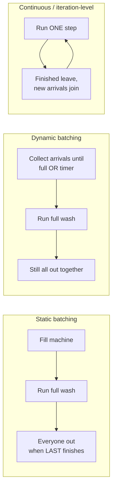
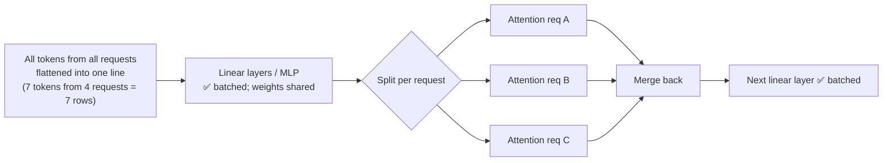
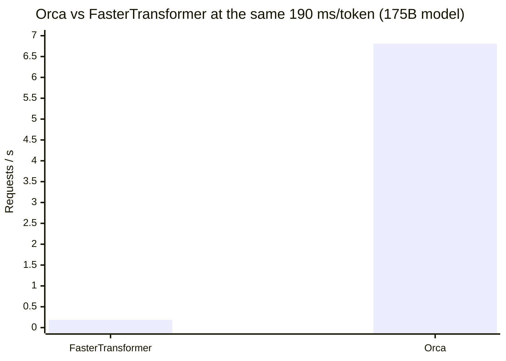
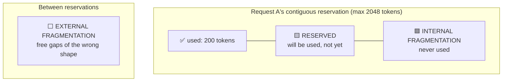
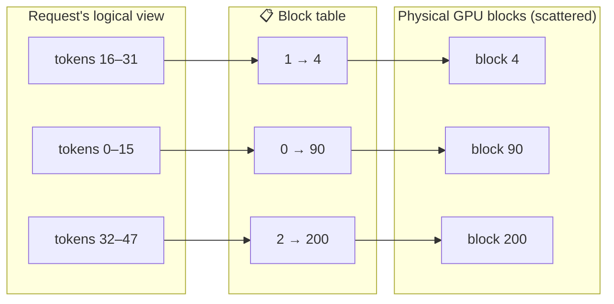
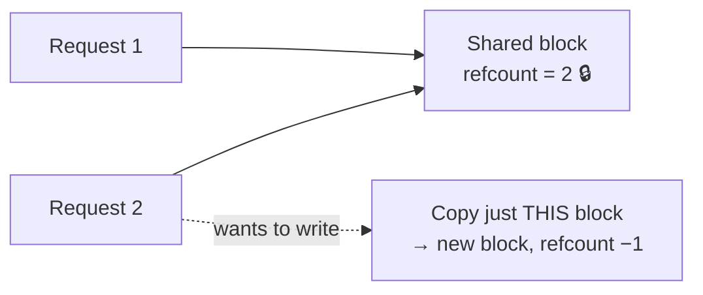
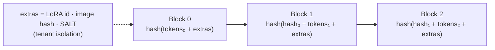
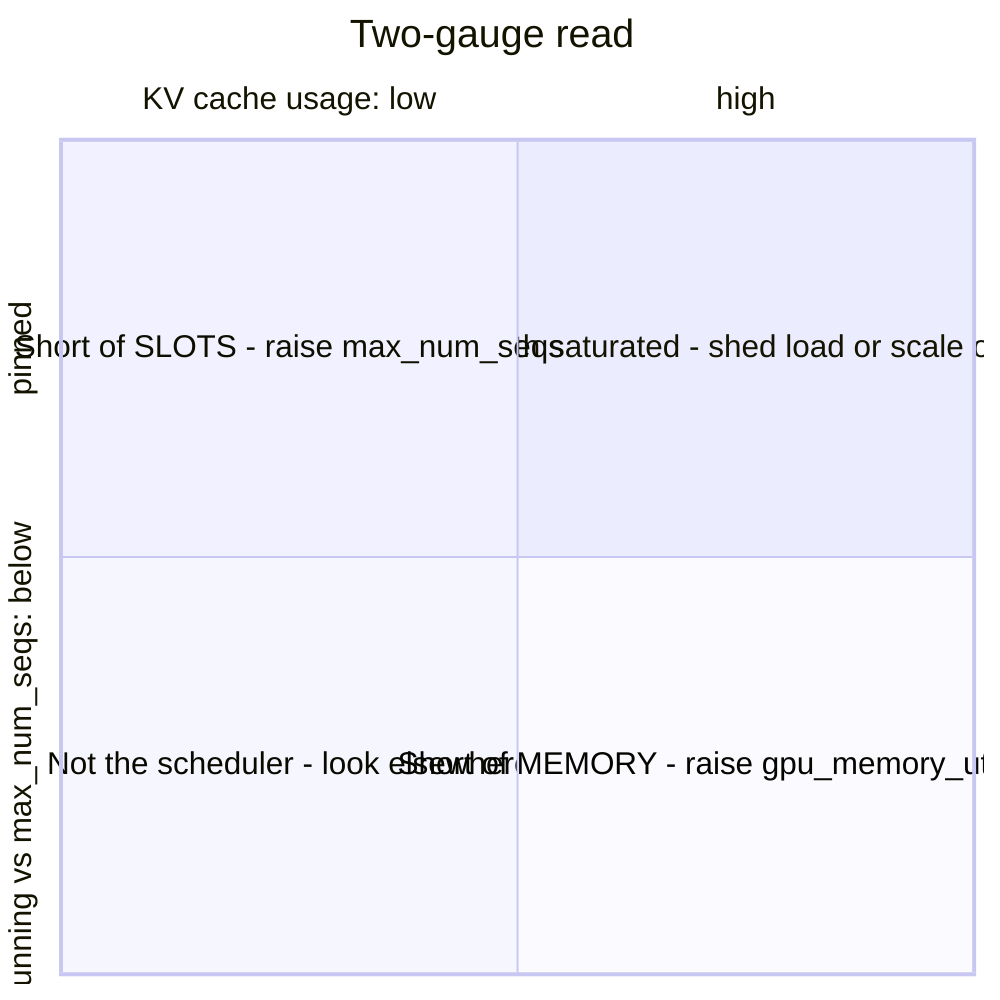

# 🧺 Chapter 4 — Batching & Scheduling

*Episodes 18 – 21*

## 1. Continuous batching (Orca, OSDI 2022)

### 🧺 The launderette analogy

**Request-level granularity costs you three things:**
1. A short request finished at step 4 is still in the batch at step 400, computing garbage
2. Everyone waits for the longest request
3. Anything arriving 1 ms after the start waits for the whole wash

**Orca's fix: iteration-level scheduling.** The engine runs **one step**, then hands control back to the scheduler, which **re-decides from scratch** (FCFS up to a max batch size).

### Selective batching: how to batch ragged requests

> Attention has **no weights of its own**, so un-batching it loses no weight reuse. That's why the split costs almost nothing.

**36.9× the traffic at the same latency**, with no faster kernel. Only the scheduling granularity changed.

- Orca reserved KV for the **max** output up front, so requests never get evicted, but memory is wasted → fixed by PagedAttention (next section).
- Orca's max batch size survives as vLLM's **`max_num_seqs`**.
- TensorRT-LLM calls it **in-flight batching**. vLLM V1 has no prefill/decode distinction in the scheduler, just `{request_id: num_tokens}`.

### CUDA graphs & `--enforce-eager`
- A decode step is a long chain of tiny kernels, so **CPU launch overhead** matters. CUDA graphs replay the whole chain as one submission.
- But **dynamic shapes are prohibited**, so vLLM captures sizes **1, 2, 4, then every 8 up to 256** and pads up (5 requests → graph for 8).
- `--enforce-eager` disables graphs **and torch.compile**. Use it for debugging or profiling; don't leave it on in production.

::: tip ✅ Homework
Compare the **actual average batch size** with what you assumed. Near 1 with a full queue means something upstream is still batching the old way. Then check whether `max_num_seqs` or the **KV cache** is your real limit.
:::

---

## 2. PagedAttention: your KV cache was mostly empty 🏨

**Measured:** only **20.4% – 38.2%** of KV memory held real tokens in pre-vLLM systems.

### Three kinds of waste (hotel analogy: booking a whole floor per guest)

Even an Orca variant **told the exact output length in advance** (an oracle) stayed **under 40%** utilization. Better reservations only move the waste around.

### The fix: OS-style paging

- Block = **16 tokens** in vLLM
- **External fragmentation: gone.** All blocks are the same size, so any free block fits anyone.
- **Internal fragmentation: capped** at ≤ 15 slots per request
- **Reserved: gone.** Blocks are allocated only when they're needed.
- **One KV manager** in the scheduler, shared by all GPU workers

### Copy-on-write sharing

Parallel sampling memory saved: **6–10%** (short shared prompt) up to **~30%** (long). The same machinery later enables **prefix caching**.

### Results & honest costs

| vs | Throughput at same latency |
| --- | --- |
| Orca-oracle | **1.7 – 2.7×** |
| Orca-greedy | **2.7 – 8×** |
| 13B batch size | **2.2×** (oracle), **4.3×** (greedy) |

- Gains shrink for a **175B model on 8 GPUs** (~640 GB): the baselines aren't memory-short there, the system becomes **compute-bound**, and allocation no longer matters.
- **Biggest wins:** long sequences, big models, multiple candidates per prompt.
- Paper-admitted cost: **20–26% slower attention kernel** (block-table lookups). vAttention measured up to **2.8×** slower than FA2 on some shapes. Today vLLM uses **FlashAttention** (Hopper) / **FlashInfer** (Blackwell), both paged, so that penalty is gone.

---

## 3. Chunked prefill & prefix caching

**Problem:** a 4K-token prompt arrives and **30 users' streams freeze** (Sarathi-Serve measured stalls of several seconds). Mixing the whole prompt into the decode batch was worse: **up to 28.3× the ITL**.

### Chunked prefill: use the slack in decode steps

> 💡 **Key number:** the linear-layer cost of **1 decode token ≈ 128 prefill tokens**. Decode is memory-bound, so there's spare compute in every step.

```mermaid
gantt
    title Stall-free schedule — every step carries decode + a prompt chunk
    dateFormat X
    axisFormat %s
    section Step 1
    Decodes (30 users) :a1, 0, 2
    Prompt chunk 1     :b1, 2, 4
    section Step 2
    Decodes (30 users) :a2, 4, 6
    Prompt chunk 2     :b2, 6, 8
    section Step 3
    Decodes (30 users) :a3, 8, 10
    Prompt chunk 3     :b3, 10, 12
```

- Knob: **`max_num_batched_tokens`** = token budget per step
- Prefill throughput saturates at about **512 tokens**. Use **512** for strict latency, **2048** when it can be relaxed.
- 🧱 **Keep it a multiple of 256**: tile boundaries mean a chunk of 257 was **32% slower** than 256.
- Re-read overhead ≤ **~25%** at 512-token chunks; almost none at 2048
- Payoff: **2.6×** capacity (Mistral-7B, 1× A100), **3.7×** (Yi-34B, 2× A100)
- ⚠️ It does **not** make prefill cheaper. It only spreads the work out.

### Prefix caching: don't prefill at all

- **Chained hashes** mean position matters (the same 16 tokens after a different prefix hash differently)
- Only **full** blocks are cached; eviction is **LRU**
- **SGLang RadixAttention**: a radix tree whose edges carry token runs; evicts the LRU **leaf**, so the shared trunk survives
- **Multi-turn chats:** without a cache, cost grows roughly **quadratically** in turns. With it, each turn costs only the new part.
- **DeepSeek production:** **56.3%** of 608B daily input tokens hit the on-disk KV cache
- **< 1%** throughput loss at a 0% hit rate, which is why it's on by default

::: warning 🔪 Hit-rate killers
1. **Anything dynamic at the top** of the prompt (timestamp, request ID, user name) → every later block misses. **Put changing content at the bottom.**
2. **Round-robin** across replicas scatters a conversation, so every replica misses → use cache-aware routing.
:::

Both techniques fix **prefill** only. For short-prompt/long-output workloads, expect **no speedup**.

---

## 4. 🩺 Clinic: the vLLM scheduler

Read **two gauges together**: running requests (vs `max_num_seqs`) and **KV cache usage** (0 → 1).

| # | Symptom | Diagnosis | Fix |
| --- | --- | --- | --- |
| 1 | Running pinned at 256, KV = 0.6 | **Short of slots** | Raise `max_num_seqs` |
| 1b | Running well below ceiling, KV ≈ 1 | **Short of memory** | ↑ `gpu_memory_utilization` → KV in fewer bits → more TP. Set `max_model_len` near the real max (it's only a **startup check**, not a cache slice) |
| 2 | Steady preemption rate > 0 for an hour, raising the limit made it worse | **Preemption death spiral**: evicted requests re-prefill, which eats the scarce capacity | Cache share **↑** first (default 0.92), then `max_num_seqs` **↓** |
| 3 | Same config: on H100 it's great, on A100 it's slower than defaults | **`max_num_batched_tokens` is GPU-dependent.** >70 GB → 8192 / 1024 seqs, else 2048 / 256. **A100 is explicitly excluded** (a big budget hurts it) | **Delete the copied flag** and let the default detect the card |

**`gpu_memory_utilization` fails both ways:** OOM at startup = set too high. Starts fine but preempts all afternoon = set too low.

**`max_num_batched_tokens` trade-off:** ↓ gives steadier ITL. ↑ gives better TTFT and throughput but spikier ITL. Guidance: ~**2048** for ITL SLOs, **> 8192** for throughput.

::: tip ✅ Homework
Put both gauges on **one panel**. Alert on **preemption rate > 0 for 5 minutes**: treat it as a bug. Raising limits when you're truly saturated lowers **goodput**.
:::
