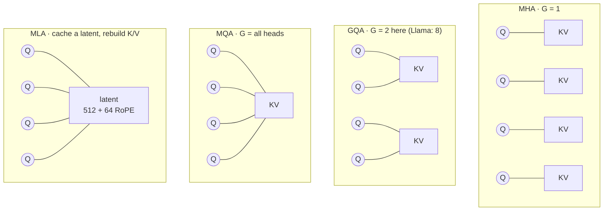
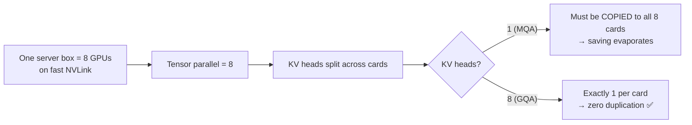
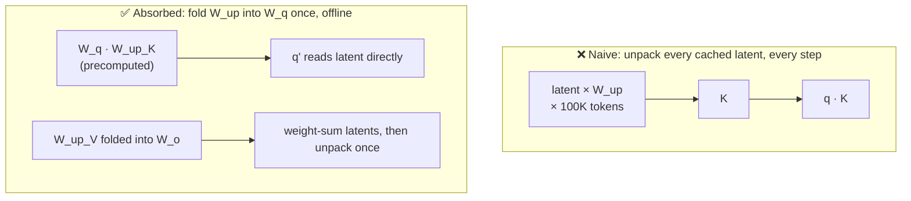
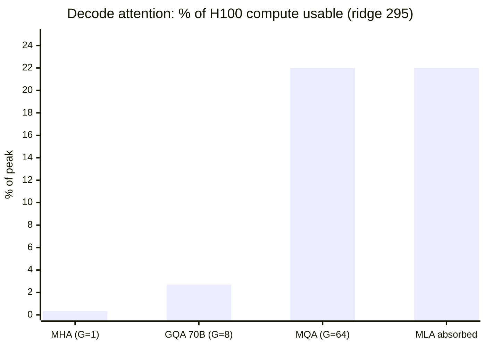
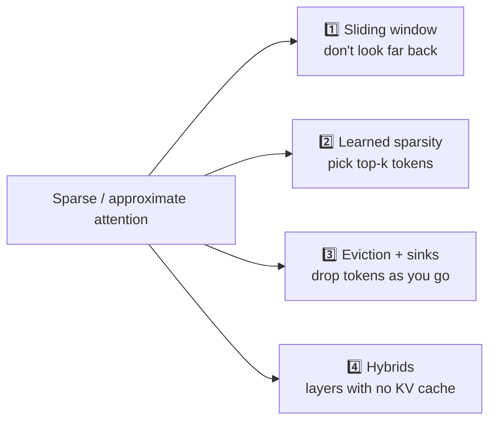
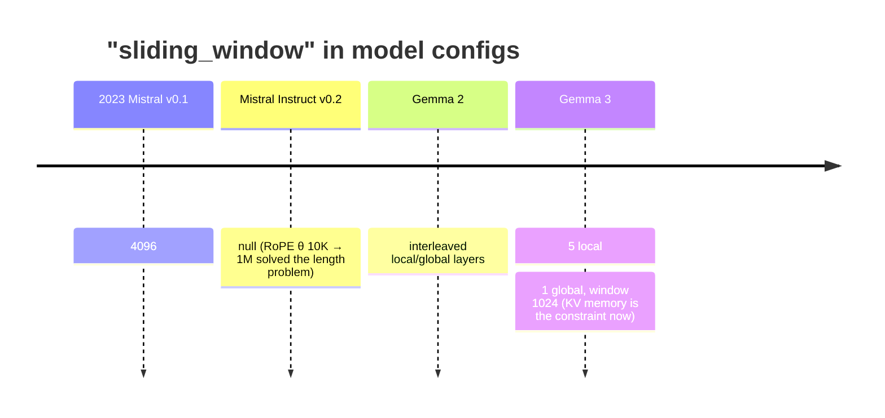
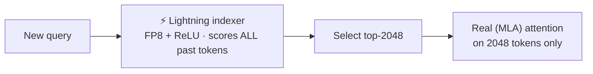
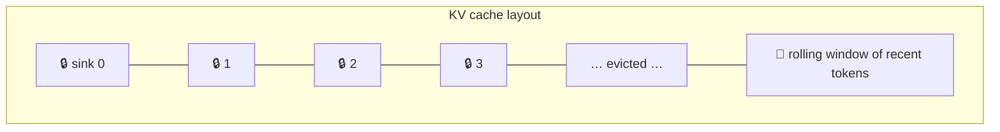
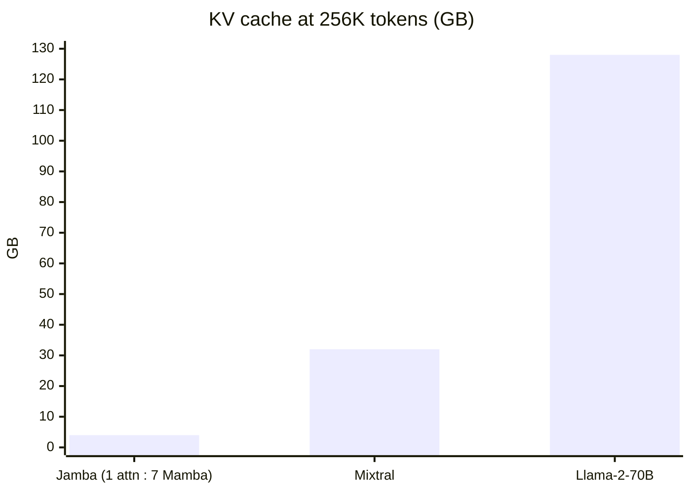

# 🧠 Chapter 5 — Attention: The Architecture Side

*Episodes 22 – 24*

## 1. One number explains MHA, MQA, GQA and MLA

Write out decode attention's FLOPs ÷ bytes and almost everything cancels: layers, sequence length, batch size, head size. What's left:

::: tip ⭐ The group size G
```
Decode attention arithmetic intensity ≈ G = query_heads / kv_heads
```
FP8 KV cache halves the bytes, so **2 × G**.
:::



| Variant | Year / lab | Idea | Result | Catch |
| --- | --- | --- | --- | --- |
| **MHA** | original | each head has its own K,V | G=1 → AI≈1 | huge cache (70B: 2.5 MB/token) |
| **MQA** | 2019 · Shazeer | **1** KV head for all queries | decoder 46 → **3.8 µs/token (12×)**, BLEU ≈ unchanged | **training instability**, worse on long-input fine-tunes |
| **GQA** | 2023 · Google | groups of queries share a KV head | T5-XXL 1.5 s → < 0.3 s (**−81%**), quality within noise | needs **uptraining: 5%** of pretrain steps (mean-pool the KV heads in each group) |
| **MLA** | DeepSeek V2/V3 | cache one compressed latent per token | KV **−93%**, peak gen throughput **~5.8×** vs their own GQA-67B; quality *stronger* than MHA | extra math; one latent → duplicated across TP cards |

### 🤔 Why does Llama 3 have 8 KV heads at every size?



Query heads go 32 → 64 → 128 (8B → 70B → 405B), while KV heads stay **8**. That 8 reflects **the deployment**, not the model. (Meta never says this outright; the GQA paper makes the duplication argument.)

### 🧩 MLA's absorb trick



Matrix multiplication is **associative**, so fold the up-projection onto the **one** query instead of the **100K** cached latents. Decode traffic then looks like MQA while the model keeps MHA's capacity. vLLM uses both paths: **compute-friendly** for prefill, **data-movement-friendly** (absorbed) for decode.

### 📊 Where each variant lands on an H100 (decode, FP16)



> After seven years, three labs and three architectures, the best one still uses only **~⅕ of the card**. To go further you have to cut **memory trips** → FlashAttention.

---

## 2. Sparse attention: the attention you don't compute

Every technique here **gives something up**, and it's never the same thing.



### 1️⃣ Sliding window attention

- Each token only attends to the last **W** tokens (Mistral: 4096). Information still travels back **one window per layer**, so 32 layers × 4096 reaches about **131K**.
- KV becomes a **rolling buffer** of W slots, so **8× less cache** at 32K. **2× faster** at 16K, with a window-aware kernel.

**The config line's history:**



Each change was right when it was made, because **the binding constraint kept moving**. Google: all-global layers cost about 60% KV overhead at 32K; interleaving brings it **< 15%** (measured at 3:1 local:global, so treat it as a direction, not the shipped number).

### 2️⃣ DeepSeek Sparse Attention (V3.2)



- Attention cost goes from O(L²) to O(L·k). The indexer only needs a **roughly right ranking**, hence FP8 + ReLU "for throughput."
- Costs: a second cache (**128 values/token** next to the latent's 576), and the indexer is **still O(L²)** during prefill. The quadratic term is cheaper but not gone, so speedups land below the complexity math.
- Benchmarks on par; **API prices cut > 50%** on launch day.

### 3️⃣ Eviction & attention sinks (StreamingLLM)



- A pure rolling window **collapses** (perplexity explodes) once the first token slides out. Why? **Softmax must sum to 1**, so the model dumps unneeded attention on the **first tokens**, the only ones visible to everyone under the causal mask.
- Fix: **pin 4 sink tokens** + a rolling window. Up to **22.2×** faster per token than sliding window with recomputation.
- Those same first tokens carry **massive activations** (Llama-2-7B: max ~2000 vs median ~0.2), which matters for quantization.

::: danger ❌ Myth: "StreamingLLM gives 4M tokens of context"
Paper: *it does not extend the models' context window.* You get **infinite stable streaming**, not long-range memory. Anything 2M tokens back is **gone**.
:::

### 4️⃣ Hybrids: layers with no KV cache

Linear attention / state-space (Mamba) layers keep a **fixed-size state**, so only the attention fraction of layers grows the cache.



Remember the **ratio**, not the model name.

| Technique | What it gives up |
| --- | --- |
| Window | distant tokens |
| Eviction | whatever left the cache |
| Learned sparsity | trusts a score that can be wrong |
| Hybrid | no attention in most layers |

> Ask whether **your workload needs the far end**. Long-document QA or summarization → a window is the wrong tool. A long chat that mostly needs recent context → a window is nearly free.

---

## 3. 🩺 Clinic: which LLM can you actually serve?

**Setup:** 128K-token conversations, the same **30 GB** KV budget for each model, FP16, one copy.

| Model | KV/token | 1 × 128K convo | Fits in 30 GB |
| --- | --- | --- | --- |
| Llama 3.1 **8B** (32 L × 8 KV × 128) | ~131 KB | ~17 GB | **1** |
| Llama 3.1 **405B** (126 L × 8 KV × 128) | ~516 KB | ~66 GB | **0** ❌ |
| DeepSeek V3 **671B** (MLA, 512 + 64) | ~70 KB | ~9 GB | **3** ✅ |

> The **biggest** model holds the **most** conversations: 3× as many as a model **80× smaller**. You can't read KV cost off the parameter count.

**Why did your quick benchmark say all three were fine?** It used 1 request, a short prompt and a short answer. 1K tokens on Llama-8B is about **130 MB** of KV against 16 GB of weights, so the KV cache barely showed up. **Benchmark at your real operating point.**

::: tip ✅ Monday checklist
1. Open `config.json` → compute **G = heads / kv_heads** and **KV bytes/token**
2. The attention design is **fixed at training time**. Converting needs about 5% of pretraining, so choose it when you choose the model.
3. Check the **KV cache precision** (FP8 doubles G's effective value)
:::
