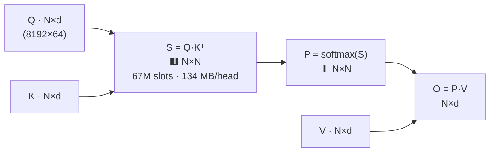
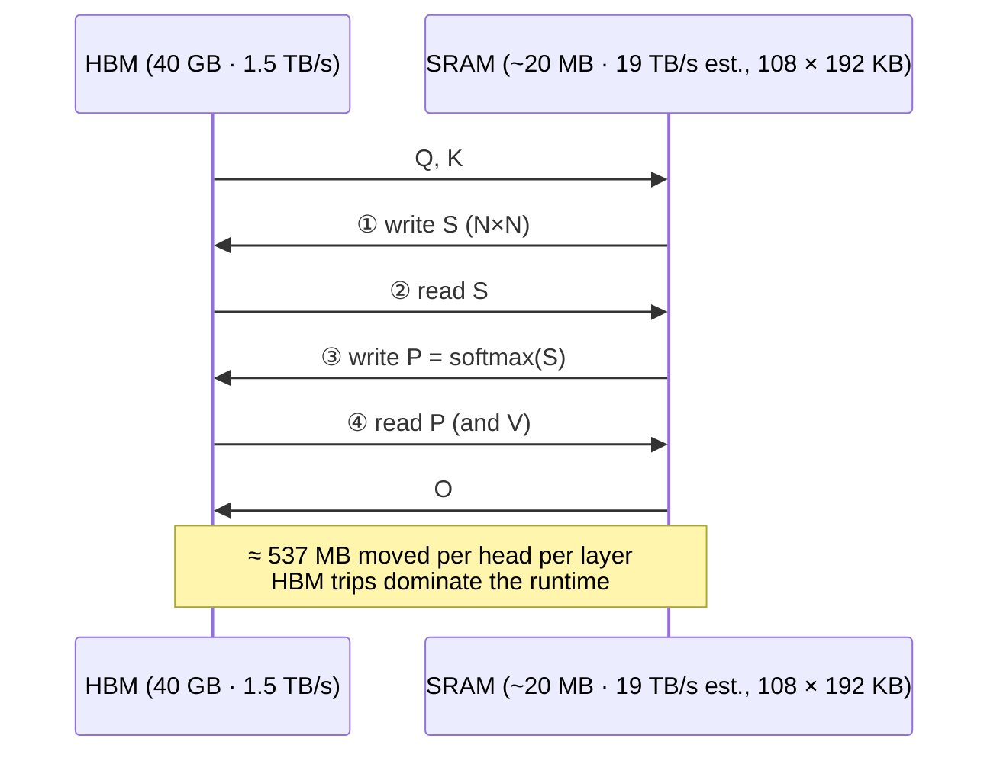
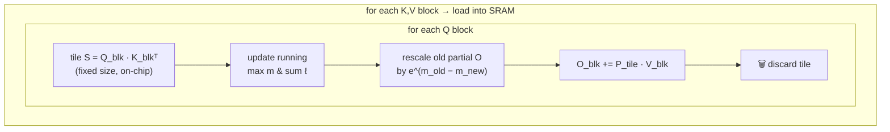
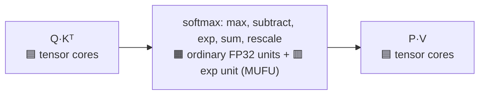
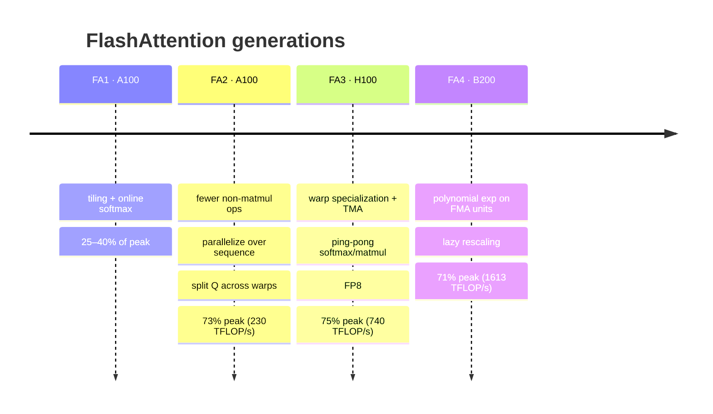
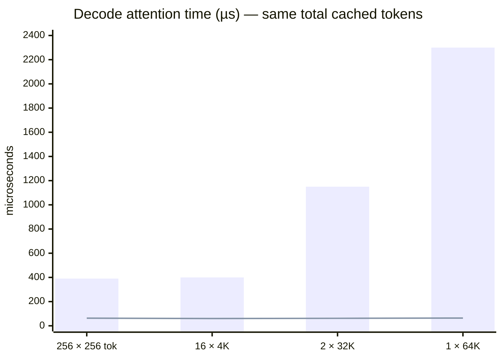
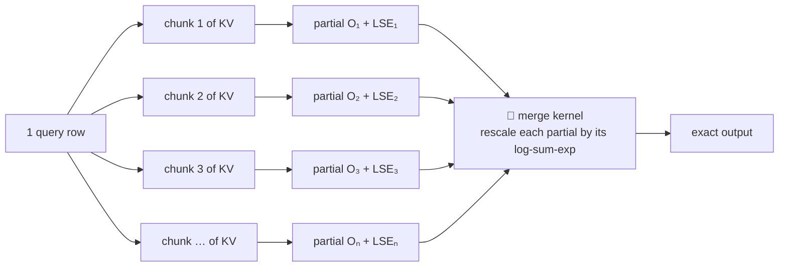

# ⚙️ Chapter 6 — Attention: The Kernel Side

*Episodes 25 – 27*

## 1. FlashAttention: never write the N×N matrix

### The shapes

**Thin in, thin out. The square only exists in the middle.** Q, K, V and O together ≈ 4 MB, while *each* square ≈ 134 MB.

### Standard attention: the square crosses HBM 4 times

### FlashAttention = tiling + online softmax

**Online softmax, worked example:** the running max is **4** and a new tile contains **5**. Everything accumulated so far is off by the same factor **e^(4−5) ≈ 0.37**. Multiply the running sum and the partial output by 0.37, and it's as if you'd known the max was 5 all along.

✅ **Exact, not an approximation.** It's the same formula in a different order (tiny float-rounding differences only). GPT-2 trained both ways reached the same quality.

### What it bought (GPT-2 medium, A100, 1K tokens, batch 64, fwd + bwd)

| | Standard | FlashAttention |
| --- | --- | --- |
| GFLOPs | ~67 | ~75 (**more** math: backward pass *recomputes* tiles) |
| HBM traffic | **40.3 GB** | **4.4 GB** |
| Time | **41.7 ms** | **7.3 ms** (> 5×) |

- Memory grows **linearly** in N instead of quadratically. First Transformer to beat chance on **Path-X** (16K): 61.4%.
- It's a **kernel**: no retraining, same weights, and it does **not** shrink the KV cache.

> When attention is slow, look at **what moves between memories** before you look at the math.

---

## 2. FlashAttention 2, 3, 4: rebuilt for each GPU's bottleneck

Inside each tile there are two kinds of work:

On A100: tensor cores do 312 TFLOP/s (FP16/BF16) vs 19.5 TFLOP/s FP32, so **each non-matmul FLOP costs ~16×**.

### 🅰️ FA2 on A100: three wastes removed
1. **Divide once at the end** instead of renormalizing after every tile
2. **Parallelize along the sequence**: FA1 made one job per (batch × head). A 16K prompt with 16 heads = **16 jobs for 108 SMs**. FA2 makes one job per **Q-row block**.
3. **Split Q (not K/V) across warps**, so the forward pass needs no warp-to-warp exchange through SRAM

→ **~2× FA1**, close to a well-tuned GEMM.

### 🅷 FA3 on H100: overlap
- FA2 reached only **35%** on H100 (vs 80–90% for a GEMM), partly because of old Ampere instructions.
- Deeper cause: the **exp unit ≈ 3.9 T/s, 256× slower** than the tensor cores. Even with 512× more matmul ops than exps, the exps take about **half** the matmul time.

```mermaid
gantt
    title FA3 ping-pong — two warpgroups alternate
    dateFormat X
    axisFormat %s
    section Producer warp
    TMA loads Q, K, V   :0, 12
    section Warpgroup 1
    GEMM                :a1, 0, 3
    softmax             :a2, 3, 6
    GEMM                :a3, 6, 9
    softmax             :a4, 9, 12
    section Warpgroup 2
    softmax             :b1, 0, 3
    GEMM                :b2, 3, 6
    softmax             :b3, 6, 9
    GEMM                :b4, 9, 12
```

→ **1.5–2× FA2**, up to **740 TFLOP/s** FP16 (75%), plus FP8 support.

### 🅱️ FA4 on B200: the exponential is the wall
- Tensor math per SM per clock **doubled**, but the exp unit is still **16 ops/SM/clock** and SRAM is still **128 B/clock**.
- 128×128 tile, d = 128, BF16 forward: **matmul 1024 cycles = exp 1024 cycles**. A tie.
- FA3 **doesn't run** on B200 (Hopper-specific instructions).

**Fixes:**
1. **Software exp**: a degree-3–5 polynomial on the FMA units for **10–25%** of each row (error ≈ hardware's after BF16 rounding)
2. **Lazy rescale**: keep the stale max and only rescale when the factor passes about **256** (per warp of 32); the final divide still gives the exact output

::: tip ✅ Takeaways
- On a **new GPU**, check which attention kernel your stack runs and whether it was **written for that chip** (FA2 vs FA3 on H100: 35% vs 75%).
- When a spec sheet says the tensor cores doubled, check **what didn't double per SM per clock**: the exp unit, SRAM bandwidth.
:::

---

## 3. Flash-Decoding: why long prompts leave the GPU idle

**Same 64K cached tokens, very different time** (A100, FP16, 16 Q heads / 2 KV heads, d = 128):

<small>Bars = FlashAttention 2 · line = Flash-Decoding (approximate)</small>

**Why?** At decode there's **one query row**, so FA2's jobs come only from **batch × heads**. 1 sequence × 16 heads = **16 jobs for 108 SMs**. Long contexts also push you toward small batches, which makes it worse.

### Split along the one dimension that's still big: the KV cache

- Splitting = **views** into the cache, so no GPU work
- **LSE** (log-sum-exp) records each chunk's total softmax weight → **exact** merge, in any order
- Result: about **56–78 µs, almost constant** up to 64K. At 64K: **~36× faster** (64 vs 2300 µs). At 128K: 107 vs 4600 µs.
- End to end on CodeLlama-34B, batch 1: **up to 8×** faster generation for very long sequences
- Available in FlashAttention **≥ 2.2** and xFormers **≥ 0.0.22** (the dispatcher picks by problem size)

### What later kernels add

| Kernel | Addition |
| --- | --- |
| **FlashInfer**: split scheduler | fair share = Σ KV lengths ÷ thread blocks. Long requests are split into ≤ share chunks; short ones run **whole with no merge**. Longest-first onto the least-loaded block. **Deterministic** (no atomics). |
| **FlashInfer**: GQA head stacking | stack the 8 query heads of a group as rows → **one KV load serves 8 heads** (TRT-LLM's XQA does something similar) |
| **FlashDecoding++**: fixed max | the synchronized max update cost **18.8%** of attention time (Llama-2-7B). Use a **fixed** subtraction constant (99.99% of scores in [−16.8, 6.5]) and recompute rows that fall outside. ⚠️ Model-dependent: OPT-6.7B's range is −497 to 363, so it's not used there. |

> At decode, **find the part of the request that's actually big**. That's where the parallel work is.
