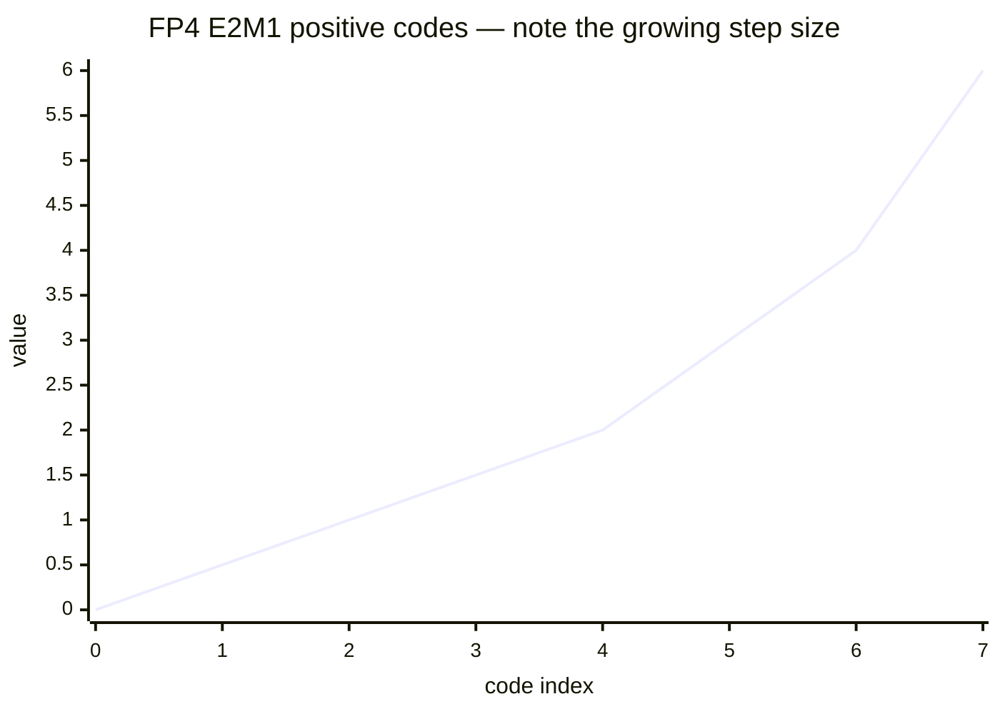
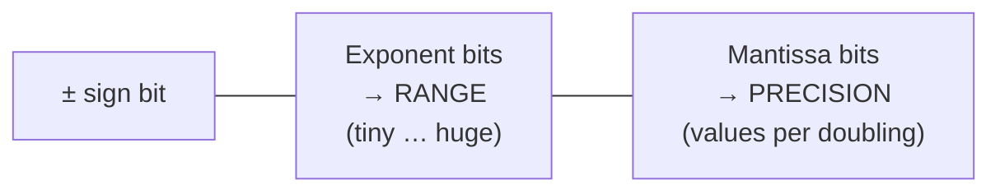
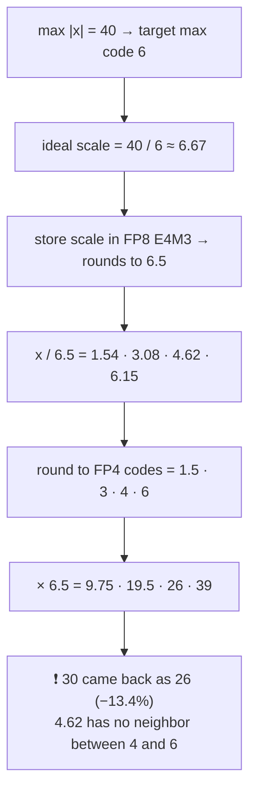
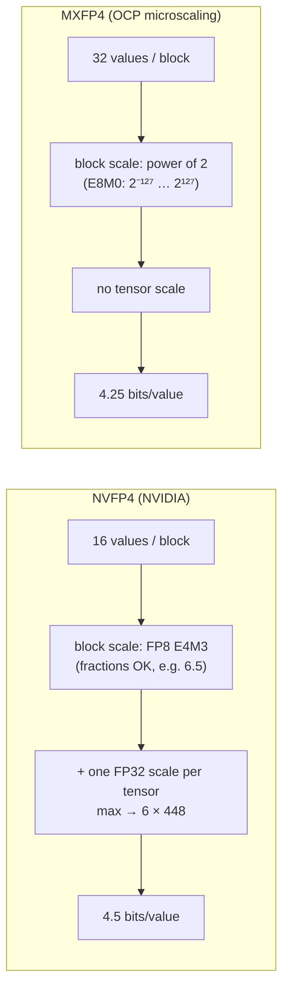
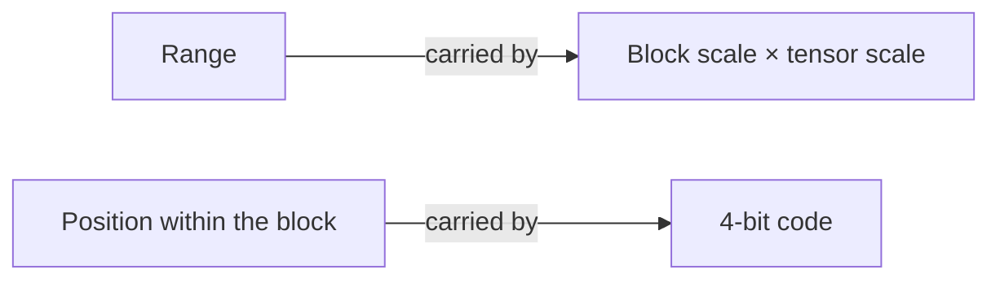

# 🔢 Chapter 7 — Quantization & Numerics

*Episode 28 · lever pulled: **move fewer bytes***

## 1. Every value FP4 (E2M1) can store

- **16 codes, 15 distinct values**: ±{0, 0.5, 1, 1.5, 2, 3, 4, 6} (with +0 and −0)
- Step sizes: **0.5** (0 → 2), **1** (2 → 4), **2** (4 → 6)
- Max = 6, only **12×** the smallest non-zero value. BF16's max is ~3.4 × 10³⁸.

> So how do BF16 weights fit in 16 codes? **Scale factors**: each small **block** of values gets its own scale.

---

## 2. Anatomy of a float

| Format | Sign · Exp · Mant | Max value | Notes |
| --- | --- | --- | --- |
| FP32 | 1 · 8 · 23 | ~3.4e38 | Matmul accumulators commonly output FP32 |
| **BF16** | 1 · **8** · 7 | ~3.4e38 | FP32's range. Trains without hyperparameter tuning |
| **FP16** | 1 · 5 · **10** | **65,504** | Overflow → **inf → NaN**. A BF16-trained model can overflow in FP16 |
| **FP8 E4M3** | 1 · 4 · 3 | **448** | **No infinity** (special codes reused for numbers; would be 240 otherwise). For **weights & activations / inference** |
| **FP8 E5M2** | 1 · 5 · 2 | 57,344 | More range, for **gradients** |
| **FP4 E2M1** | 1 · 2 · 1 | 6 | Needs **per-block** scales |

**FP8 recipe:** scale each tensor so its **max magnitude ≈ the FP8 max**, then clamp overflow. Casting with **no scale** caused significant accuracy loss. One scale per tensor works for FP8 (E4M3 spans ~18 doublings) but **not for FP4** (~3.5 doublings): after scaling, anything below **0.25** (half of the smallest step) rounds to **zero**.

---

## 3. 🧮 NVFP4 worked example (one block)

Block = [10, 20, 30, 40] (a 4-value toy; real NVFP4 blocks have 16)

> Values **near the top of a block** take the biggest absolute rounding errors, because that's where the step is 2 wide.

---

## 4. NVFP4 vs MXFP4

### Why power-of-two scales hurt
Block max ≈ 3.1. The ideal scale is just over 0.5. With powers of two, **0.5** would push the top value past 6, so you **round up to 1**. The top value then reaches only ~3, codes **4 and 6 go unused**, and you lose almost a whole doubling out of ~3.5.

| Comparison | Result |
| --- | --- |
| NVIDIA illustration, MSE with power-of-2 scales vs E4M3 scales | **0.72 vs 0.08** (~9× lower) |
| Meta analysis (Llama-3.1-8B-Instruct, Qwen3-8B): finer E4M3 scale | **+3–4 dB** QSNR |
| Same: halving the block 32 → 16 | **+~1 dB** QSNR |
| Same: activations rounded to zero, 32 → 16 block | **20% → 13%** |

> **The scale's precision matters more than the block size.** The largest value in each NVFP4 block comes back at close to FP8 precision.

---

## 5. ✅ Before you pick a format

::: tip Checklist
1. **Fewer bits = fewer bytes**, so decode (memory-bound) speeds up. For a batch-1 8B model on an H100: FP16 → FP8 gives exactly **2×** (209 → 418 tok/s). See [Chapter 2](./02-two-walls.md).
2. Fewer bits **≠ automatically faster math**. Check the math rate for **that format on that GPU**.
3. Accuracy loss at 4 bits **depends on the model**, so measure on yours. (Remember the attention sinks' **massive activations**, ~2000 vs a median of 0.2.)
4. When you look at a 4-bit format, **look at how it stores its scale first**.
5. The ridge point **moves with precision**: H100 FP16 = 295 → FP8 ≈ 590.
:::

> The 16 codes never had to cover the whole model's range. **The scales carry the range; the codes only say where a value sits inside its block.**
