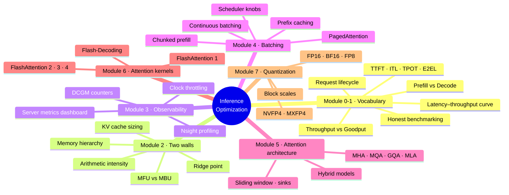
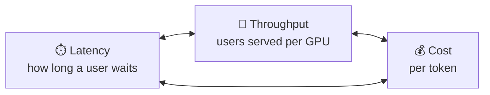
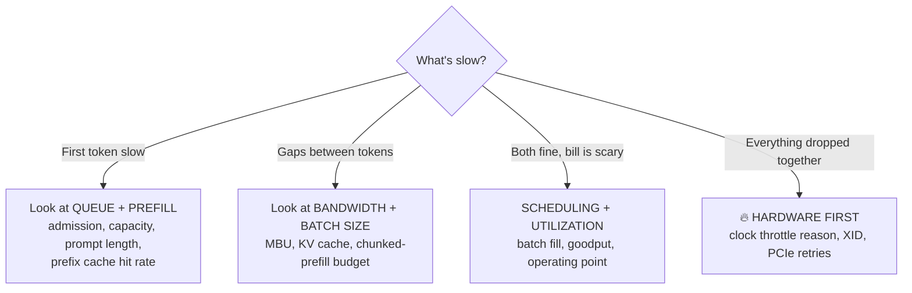

# ⚡ **LLM Inference Optimization — Notes**

::: tip 📺 Source
Notes from the YouTube course **[Inference Optimization: From First Principles to Production](https://www.youtube.com/playlist?list=PLXV1pCewfApE)** by Mani Khanuja (*The Agentic Enterprise*). 29 episodes, covering Modules 0 – 7.
:::

> **Training is buying the car. Inference is the taxi meter** — it starts with your first user and never stops.

---

## 🧭 The whole course on one page

---

## 🎛️ The two rules that hold everything together

### 1. You can optimize only **two of three**

They're **one budget**, not three separate goals. Push latency down and you serve fewer users per GPU, so cost goes up. Pack more users in and everyone waits longer.

### 2. Every technique pulls one of **four levers**

| Lever | Examples in this course |
| --- | --- |
| 📦 **Move fewer bytes** | Quantization, GQA/MLA, KV-cache compression, FlashAttention |
| 🧮 **Do fewer calculations** | Sparse attention, sliding windows, prefix caching |
| 🤝 **Share work across requests** | Batching, continuous batching, prefix caching, copy-on-write |
| 🔀 **Overlap work** | Chunked prefill, FlashAttention 3 ping-pong, API/engine process split |

::: info 💸 Why it matters — DeepSeek's real meter (Feb 2025)
One day of production cost **$87,072**. At their list R1 pricing the same tokens would have been worth **more than 6×** that (DeepSeek themselves call this figure theoretical). Engineering closes most of that gap. Pricing doesn't.
:::

---

## 📚 Chapters

| # | Chapter | Episodes |
| --- | --- | --- |
| 0 | [🚕 Orientation & the request map](./00-orientation.md) | 00 – 01 |
| 1 | [🛣️ Request lifecycle, metrics & benchmarking](./01-lifecycle-metrics.md) | 02 – 07 |
| 2 | [🧱 The two walls: compute vs memory](./02-two-walls.md) | 08 – 13, 17 |
| 3 | [🔭 Observability: what to measure](./03-observability.md) | 14 – 16 |
| 4 | [🧺 Batching & scheduling](./04-batching-scheduling.md) | 18 – 21 |
| 5 | [🧠 Attention: the architecture side](./05-attention-architecture.md) | 22 – 24 |
| 6 | [⚙️ Attention: the kernel side](./06-attention-kernels.md) | 25 – 27 |
| 7 | [🔢 Quantization & numerics](./07-quantization.md) | 28 |

---

## 🩺 The master diagnosis tree

Start from the **symptom**, then find the cause:

::: warning 🧠 The one number the course leans on
**Arithmetic intensity** (FLOPs per byte moved) vs the GPU's **ridge point**. If you remember one idea, remember this one → [Chapter 2](./02-two-walls.md).
:::
