# 🚀 How LLM Serving Works: vLLM & SGLang

*Notes from the lecture [How LLM Serving Works: An Introduction to vLLM and SGLang](https://www.youtube.com/watch?v=vM3kzJIPvvw) by Dr. Sreedath Panat (Vizuara).*

::: tip 🧭 The whole lecture in one line
A GPU is **very fast at maths** but **slow at moving data**. vLLM and SGLang are clever "managers" that let **one GPU serve many users at once** without wasting memory. Result: the same 1 million users cost about **6× less**.
:::

We follow **one example** the whole way, so the numbers stay simple:

| Thing | Value |
| --- | --- |
| 🤖 Model | **Llama 3.1 8B** (8 billion numbers called *weights*) |
| 🖥️ GPU | **One NVIDIA H100** (80 GB memory) |
| 💵 GPU rent | about **$2.5 per hour** |

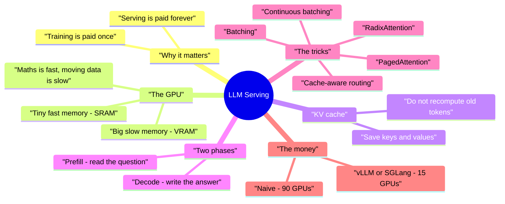

---

## 1. 💸 Why serving matters more than training

Think of a restaurant 🍽️:

- **Training** = building the kitchen. Very expensive, but you pay **once**.
- **Serving (inference)** = cooking every meal for every customer. Cheap per meal, but you pay **every day, forever**.

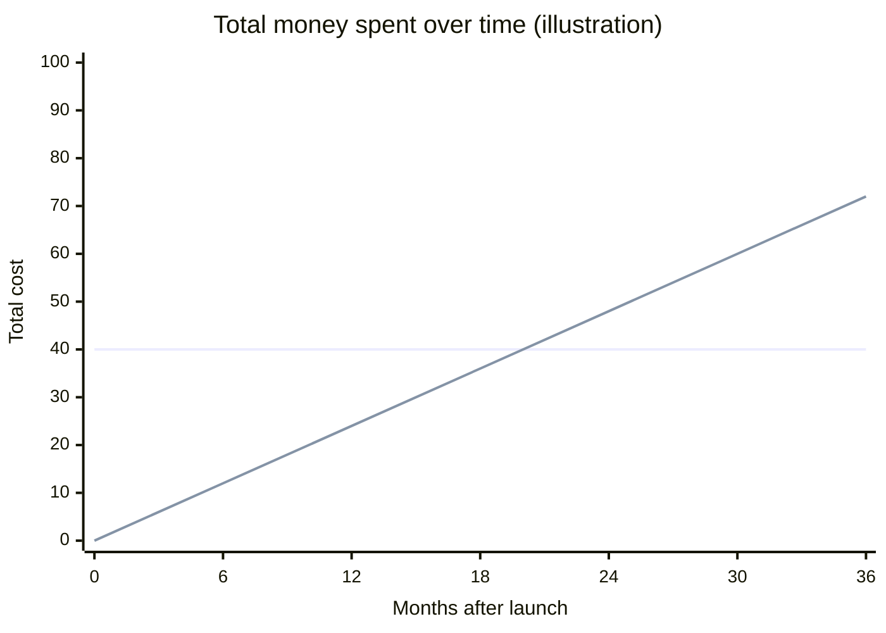
<small>Flat line = training (one-time). Rising line = serving (adds up every month). Sooner or later, serving costs more.</small>

That's why so many companies work on making inference **cheaper and faster**.

### 📊 How much work is "1 million users"?

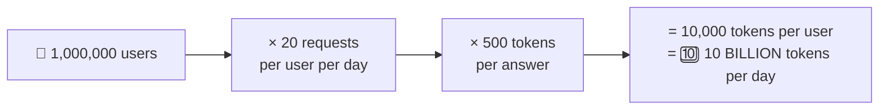

And this is a **light** user. People using coding agents easily burn 200,000 tokens a day.

---

## 2. 🧰 What are vLLM and SGLang?

A trained model is just a big file of numbers. **Someone has to actually run it**: multiply the numbers with your input, layer by layer, to get the next word. That "someone" is an **inference engine**.

| | vLLM | SGLang |
| --- | --- | --- |
| Full name | No official one (people say "virtual") | Started as *Structured Generation Language* |
| Came from | UC Berkeley | Also has a UC Berkeley team |
| Famous idea | **PagedAttention** | **RadixAttention** |
| Used for | Serving open models (Llama, Mistral, DeepSeek…) to **many users** | Same |

> **In one sentence:** vLLM and SGLang are engines that run an LLM for **thousands of users at the same time**, efficiently.

🆚 **What about llama.cpp?** That's for **one person on one device** (your laptop or phone). vLLM/SGLang are for **many people on a server**.

---

## 3. 🖥️ Inside a GPU: the warehouse and the workbench

A GPU has two kinds of memory. The easiest way to picture it:

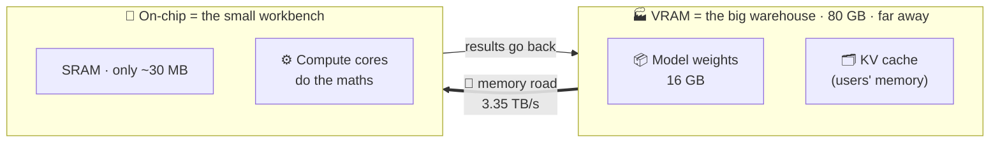

- The **warehouse (VRAM)** is big, so the whole model lives there.
- The **workbench (SRAM)** is where the maths happens, but it is **tiny**: 30 MB. Even **one** layer of the model (~500 MB) doesn't fit!
- So the GPU keeps **carrying small pieces** of the model from the warehouse to the workbench, doing the maths, and sending the result back.

### Why does Llama 8B take 16 GB?

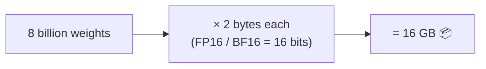

Big frontier models may have **trillions** of weights, so they need **thousands of GB**. That's why we use a small model in this example.

### ⚡ The big surprise: maths is fast, carrying is slow

To make **one** new token, the GPU must carry **all 16 GB of weights** to the workbench once.

| Step | Calculation | Time |
| --- | --- | --- |
| 🚚 Carry weights | 16 GB ÷ 3.35 TB/s | **≈ 4.8 ms** |
| ⚙️ Do the maths | 16 billion operations ÷ 989 trillion per second | **≈ 0.016 ms** |

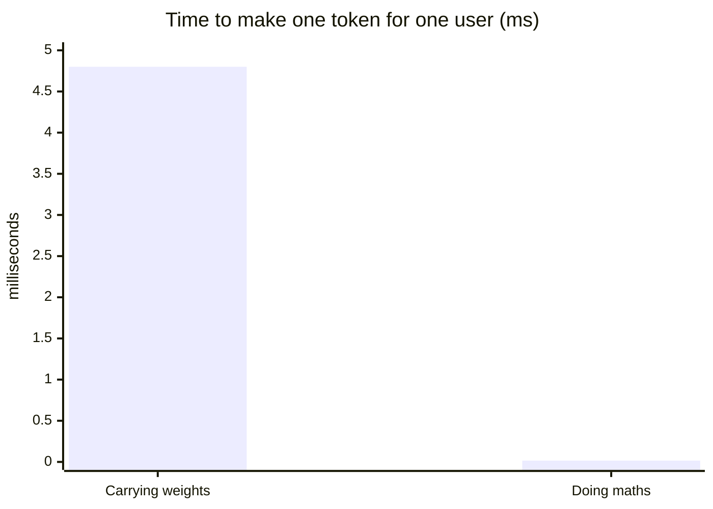

> 🐢 Carrying takes about **300× longer** than the maths. We say serving is **memory-bound**: the road is the bottleneck, not the workers.

So one user alone gets about **1 ÷ 4.8 ms ≈ 200 tokens per second**, and the cores sit mostly idle. Keep this in mind; it's the key to everything that follows.

---

## 4. 📖✍️ Prefill vs decode: reading vs writing

An LLM writes **one token at a time**, then adds it to the input and goes again:

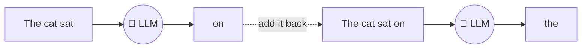

There are **two phases**, and they behave very differently:

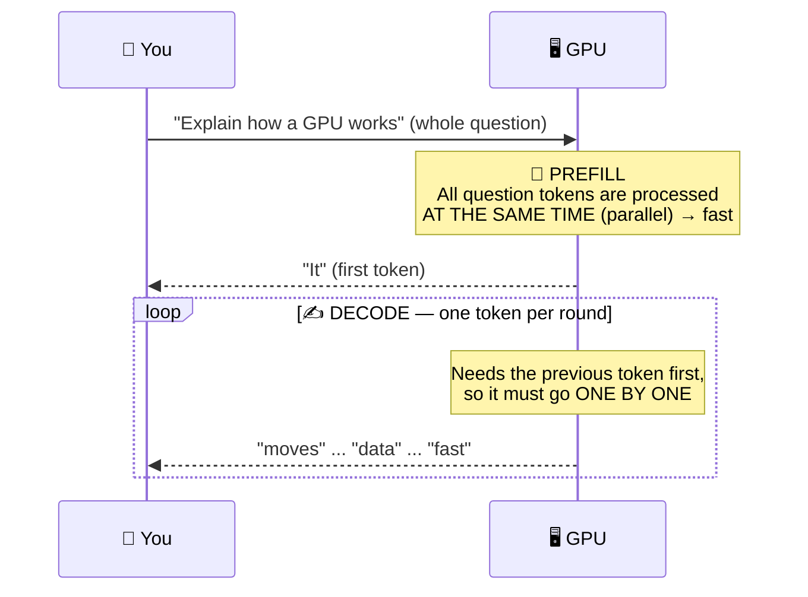

| | 📖 Prefill | ✍️ Decode |
| --- | --- | --- |
| What | Reading your question | Writing the answer |
| How | All tokens **at once** | **One token at a time** |
| Why | You already gave all the words | Can't write word 5 before word 4 exists |
| Feels like | Very fast | The "typing" you watch |

💡 **Try it:** paste a huge document into ChatGPT and ask a question. The answer starts almost instantly, because the whole document is "read" in parallel during prefill.

### ⏱️ What the user actually feels

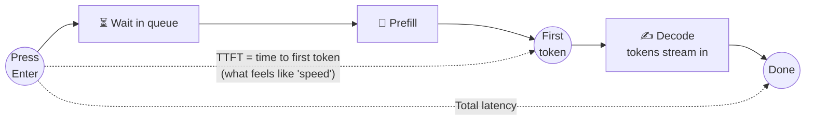

That's why apps **stream** words as they come: you only "feel" the wait until the first token (**TTFT**), not the whole answer.

**Typical speeds:** hundreds of tokens/s on a server GPU is good. A small model on a phone gets about 18–30 tokens/s.

---

## 5. 🗂️ The KV cache: the model's notebook

### A tiny bit of attention (no scary maths)

Each word is turned into three vectors (lists of numbers):

| Vector | Simple meaning |
| --- | --- |
| **Q** (query) | "What am I looking for?" |
| **K** (key) | "What do I contain?" (a label) |
| **V** (value) | "Here is my actual information" |

To make the next word, the **newest** word's **Q** is compared with the **K** of every earlier word. Those scores decide how much of each earlier word's **V** to mix in.

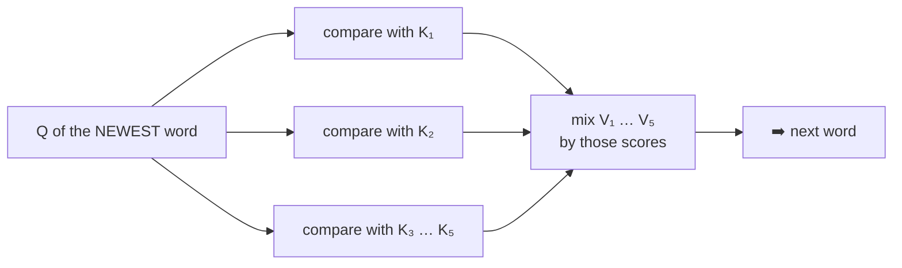

### ❓ Why save K and V, but not Q?

- **Q** is only needed for the **newest** word. Once used, throw it away. 🗑️
- **K and V** of **every old word** are needed again **every single round**.

So we save K and V in a notebook = the **KV cache**. Without it, the model would re-read the whole conversation for every new word.

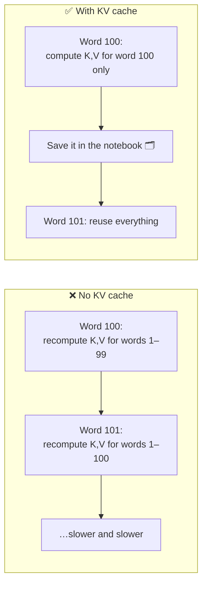

### 🧮 How big is the notebook?

For Llama 3.1 8B, **per token**:

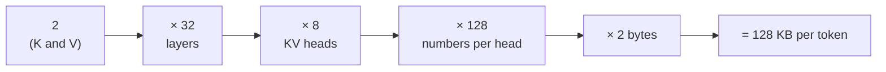

<small>Why only 8 KV heads? Llama uses **grouped-query attention**: 4 query heads share one set of keys and values, which shrinks the cache 4×.</small>

| Context size | KV cache for **one** user |
| --- | --- |
| 1 token | 128 KB |
| 2,500 tokens (~4 pages) | **≈ 320 MB** |

### 🧠 How many users fit on one H100?

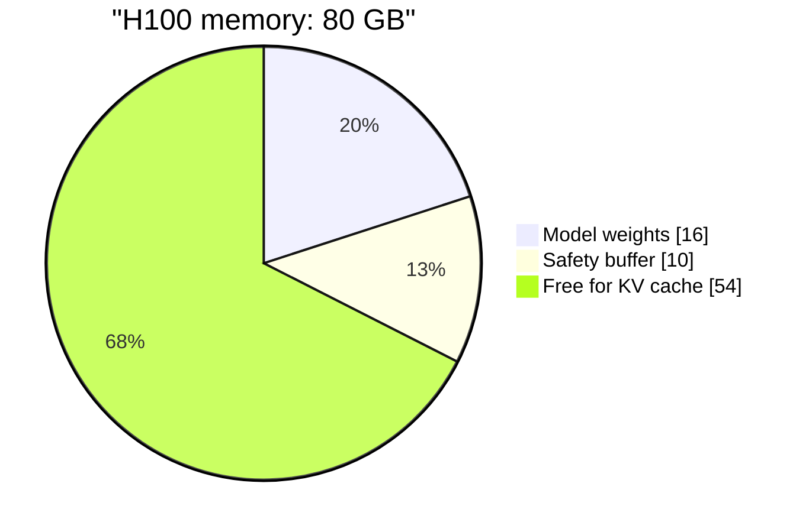

**54 GB ÷ 0.32 GB per user ≈ 160 users** (at 2,500 tokens each).

⚠️ If users want **longer** chats (more pages), each user's notebook grows and **fewer users fit**. This is the core problem vLLM and SGLang attack.

---

## 6. 🚐 Batching: fill the van

Remember: carrying weights is the slow part. So **once the weights are on the workbench, use them for everyone!**

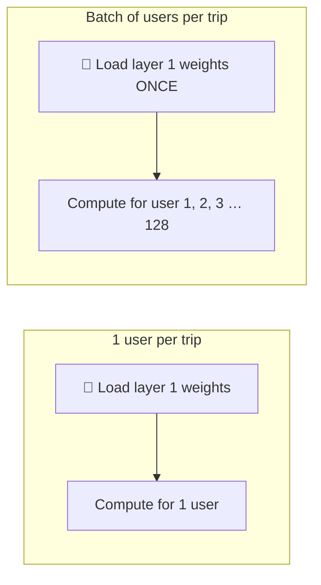

It's like a delivery van 🚐: the drive costs the same whether it carries 1 parcel or 100. So fill it up.

| | Users per GPU | Tokens per second (whole GPU) |
| --- | --- | --- |
| One user only | 1 | ~200 |
| Batched | 64–128 | **~8,000** |

Each user waits only a **little** longer, but the GPU does **40× more work**. Each user also gets their own next token, even if one is on word 2 and another on word 2,342.

---

## 7. 🏗️ What's inside one inference engine

A company has many GPUs. Each one runs a **copy (replica)** of the model with vLLM or SGLang.

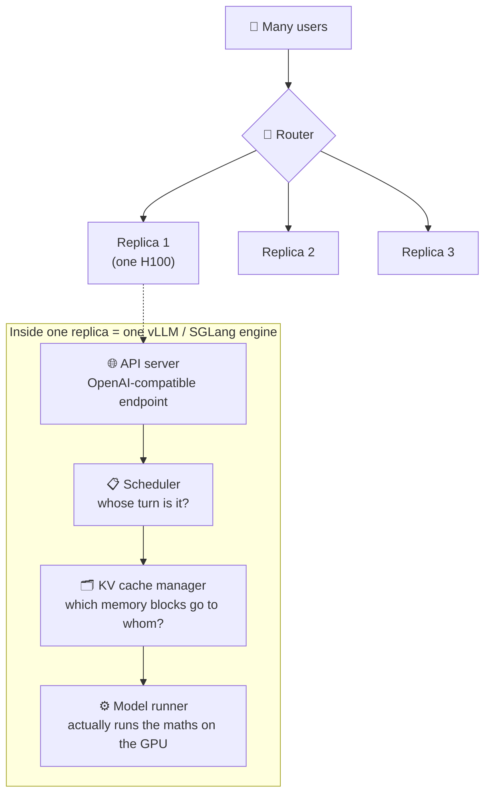

### 🎯 Cache-aware routing

You asked a question and Replica 1 answered. Now you ask a **follow-up**. Where should it go?

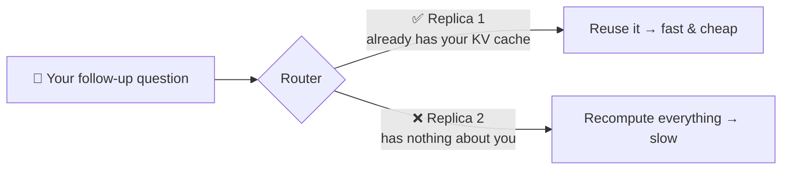

> A smart router **remembers where your notebook lives** and sends you back there. This is **cache-aware routing**.

### 🧱 Who does what?

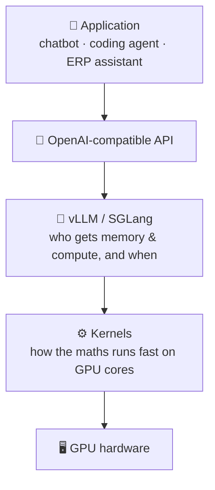

- **Inference engineer:** works on the vLLM/SGLang layer (scheduling, memory).
- **Kernel engineer:** works one layer below (making the maths on the cores fast).

---

## 8. 📄 Trick #1: PagedAttention (vLLM)

### The problem: booking seats you never use

Old servers reserved a **big, continuous chunk** of memory per user, sized for the **longest possible** answer. But nobody knows how long an answer will be.

- "What's the capital of France? One word." → needs a **tiny** notebook.
- "Explain this 5-page document." → needs a **huge** one.

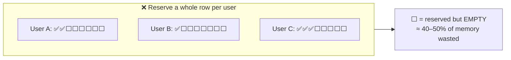

### The fix: small pages, placed anywhere

Like a computer's operating system (virtual memory), split memory into **small pages**. In this example a page holds **16 tokens ≈ 2 MB**.

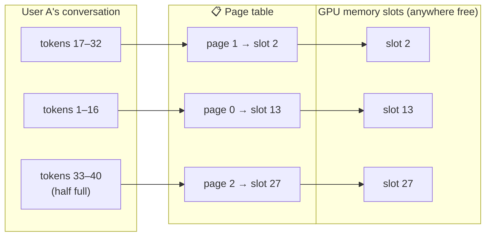

- Get a new page **only when the last one is full**.
- So each user has **at most one** half-empty page. Almost no waste!
- When a user leaves, their pages are **freed** and given to someone new. ♻️

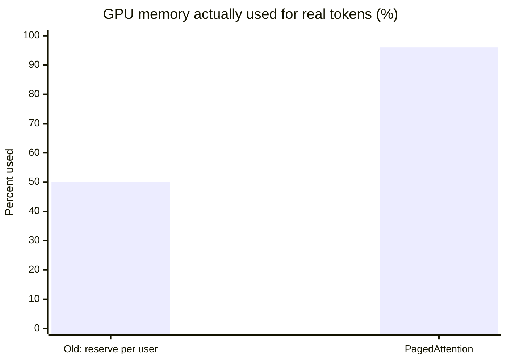

Result in the lecture's example: about **164 chats** fit on one H100.

---

## 9. 🔄 Trick #2: Continuous batching

### ❌ Static batching: wait for the slowest

Like a bus 🚌 that only leaves when **every** passenger has reached the last stop:

```mermaid
gantt
    title Static batching — everyone waits for the longest answer
    dateFormat X
    axisFormat %s
    section Slot 1
    Working        :0, 10
    section Slot 2
    Working        :0, 3
    Idle (wasted)  :crit, 3, 10
    section Slot 3
    Working        :0, 6
    Idle (wasted)  :crit, 6, 10
    section Slot 4
    Working        :0, 2
    Idle (wasted)  :crit, 2, 10
```

### ✅ Continuous batching: fill a seat the moment it's free

```mermaid
gantt
    title Continuous batching — a new user jumps in as soon as a slot frees up
    dateFormat X
    axisFormat %s
    section Slot 1
    User A   :0, 10
    section Slot 2
    User B   :0, 3
    User E   :3, 10
    section Slot 3
    User C   :0, 6
    User F   :6, 10
    section Slot 4
    User D   :0, 2
    User G   :2, 7
    User H   :7, 10
```

The engine checks **after every token step**: "Who finished? Who is waiting? Swap them in." No idle seats.

---

## 10. 🌳 Trick #3: RadixAttention / prefix caching (SGLang)

### The idea: don't redo the same work

A company chatbot gives **every** user the **same long system prompt**. Why compute its KV cache again for every user?

```mermaid
flowchart TD
    SP["📜 Shared system prompt<br/>(computed ONCE)"] --> Q1["❓ 'What are your opening hours?'<br/>(computed once, shared)"]
    SP --> Q2["❓ 'Track my order'"]
    Q1 --> A1["User A's answer"]
    Q1 --> A2["User B's answer"]
    Q2 --> A3["User C's answer"]
```

- If users share the **same beginning** (prefix), compute its K and V **once** and **reuse** it.
- SGLang stores these shared beginnings in a **tree** (a *radix tree*), so any matching start can be found quickly.
- Huge win for **coding agents**: the giant project prompt stays the same while you only ask "make this button blue".

::: info 🤔 "But LLMs are stateless!"
True: the model still **uses** all the old keys and values for every new token. RadixAttention just means they're **reused, not recomputed**.
:::

---

## 11. 💰 The full cost math: naive vs vLLM/SGLang

Same goal: **10 billion tokens per day** on H100s at **$2.5/hour**.

```mermaid
flowchart TD
    subgraph NAIVE["🐢 Simple server"]
      direction TB
      n1["16 users at once"] --> n2["Move 16 GB weights + 16 × 0.3 GB KV<br/>≈ 21 GB per step"]
      n2 --> n3["21 GB ÷ 3.35 TB/s ≈ 6.2 ms per step"]
      n3 --> n4["16 tokens ÷ 6.2 ms ≈ 2,600 tok/s"]
      n4 --> n5["Half wasted → ~1,300 tok/s"]
    end
    subgraph SMART["🚀 vLLM / SGLang"]
      direction TB
      s1["128 users at once"] --> s2["Move ≈ 54 GB per step"]
      s2 --> s3["54 GB ÷ 3.35 TB/s ≈ 16 ms per step"]
      s3 --> s4["128 tokens ÷ 16 ms ≈ 8,000 tok/s"]
      s4 --> s5["PagedAttention → almost no waste"]
    end
```

Notice: each step is **slower** (16 ms vs 6.2 ms), but it makes **8× more tokens** per step. That's batching paying off.

| | 🐢 Simple server | 🚀 vLLM / SGLang |
| --- | --- | --- |
| Users at once | 16 | 128 |
| Tokens per second per GPU | ~1,300 | ~8,000 |
| Tokens per hour | ~4.7 M | ~29 M |
| **Cost per 1 M tokens** | **~$0.54** | **~$0.09** |
| Tokens per GPU per day | ~112 M | ~690 M |
| **GPUs for 10 B tokens/day** | **~90** | **~15** |
| **Yearly GPU bill** | **~$2.0 M** | **~$0.33 M** |

```mermaid
xychart-beta
    title "Yearly GPU bill for 1 million users (million $)"
    x-axis ["Simple server", "vLLM / SGLang"]
    y-axis "Million dollars per year" 0 --> 2.2
    bar [2.0, 0.33]
```

> 🎉 **About 6× cheaper**, same model, same GPUs, same answers. Only the **software** changed.

::: details 🧮 Show the full arithmetic
**Simple server**
- 1,300 tok/s × 3,600 s = 4.68 M tokens/hour → $2.5 ÷ 4.68 = **$0.53 per M tokens**
- 1,300 × 86,400 s = 112 M tokens/day → 10 B ÷ 112 M ≈ **89 → 90 GPUs**
- 90 × $2.5 × 24 × 365 ≈ **$1.97 M/year**

**vLLM / SGLang**
- 8,000 tok/s × 3,600 = 28.8 M tokens/hour → $2.5 ÷ 28.8 = **$0.087 per M tokens**
- 8,000 × 86,400 = 691 M tokens/day → 10 B ÷ 691 M ≈ **14.5 → 15 GPUs**
- 15 × $2.5 × 24 × 365 ≈ **$0.33 M/year**
:::

<small>The lecturer noted these are rough, back-of-the-envelope numbers. A simple server could squeeze in a few more users, and vLLM could fit ~256. Both sides would shift, but the gap stays about the same.</small>

---

## 12. 🔭 Beyond this lecture

vLLM and SGLang do **much more** than these three tricks, for example:

- **Quantization**: store weights in fewer bits, so there's less to carry. 🚚
- **Speculative decoding**: guess several tokens cheaply, then check them in one go.

👉 For a deeper dive into these and more, see my [**Inference Optimization notes**](<../Inference Optimization/index.md>).

---

## ✅ Cheat sheet (remember these)

::: tip 📌 10 things to remember
1. **Serving costs more than training** over a model's life.
2. Llama 8B = 8 B weights × 2 bytes = **16 GB**.
3. GPU = big slow **VRAM** (80 GB) + tiny fast **SRAM** (~30 MB).
4. **Carrying data is the bottleneck**, not maths (4.8 ms vs 0.016 ms).
5. **Prefill** reads the question in parallel; **decode** writes one token at a time.
6. **KV cache** saves K and V (not Q) so old tokens aren't recomputed. ~**128 KB/token** for Llama 8B.
7. **Batching** = load weights once, serve many users.
8. **PagedAttention** = small pages placed anywhere → ~96% memory used.
9. **Continuous batching** = a finished user's seat is refilled right away.
10. **RadixAttention** = shared prompt beginnings computed once and reused.
:::

```mermaid
flowchart LR
    P["🐢 Problem:<br/>memory-bound GPU"] --> B["🚐 Batching<br/>use each weight load<br/>for many users"]
    B --> M["❗ Now memory<br/>limits how many users fit"]
    M --> PA["📄 PagedAttention<br/>no wasted memory"]
    M --> CB["🔄 Continuous batching<br/>no idle seats"]
    M --> RA["🌳 RadixAttention<br/>no repeated work"]
    PA & CB & RA --> WIN["💰 ~6× cheaper serving"]
```
